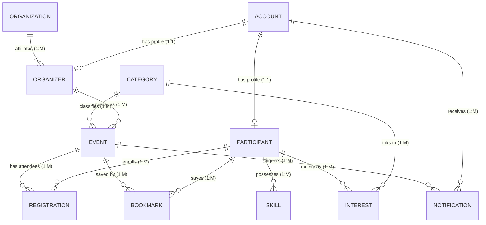

# 🎓 UniScout: Event & Opportunity Management System

[](https://www.unisza.edu.my)
[](https://www.unisza.edu.my)
[](#-team--contributors-group-sentry)
[-02569B?logo=flutter&logoColor=white)](uniscout_app/)
[](database/api.php)
[](database/README.md)

> **UniScout** is a centralized campus event and co-curricular opportunity ecosystem designed for **Universiti Sultan Zainal Abidin (UniSZA)**. It connects students, verified campus organizers, and university administrators through a Flutter mobile/desktop application backed by a PHP REST API and a normalized MySQL 8.0 database.

---

## 📌 Project Overview

Traditional campus event dissemination often relies on fragmented messaging channels, resulting in missed deadlines, low student turnout, and manual administrative overhead. **UniScout** addresses this with a unified, role-based platform:

### Core Capabilities by Role
- **Participants (Students)**
  - Account sign-up/sign-in and profile management (faculty, program, academic year, contact info).
  - Personalized **Interests** and **Skills** tagging for event & opportunity matching.
  - **Event Discovery & Filtering** by category, mode (`Physical`, `Online`, `Hybrid`), and eligibility.
  - **One-Tap Registration** with structured reference IDs, capacity tracking, and admission passes.
  - **Bookmarks & Notifications** for saved opportunities, reminders, and status updates.
- **Organizers (Clubs & Campus Bodies)**
  - Create, edit, and manage campus events (`Draft`, `Pending`, `Approved`, `Cancelled`).
  - Track event capacity, participant registrations, and review feedback from admins.
- **Administrators**
  - Review, approve, or reject submitted campus events with review remarks.
  - Manage user accounts, roles (`participant`, `organizer`, `admin`), and account statuses.
  - Verify and oversee campus organizations (`Pending`, `Approved`, `Suspended`, `Rejected`).
  - Monitor platform-wide turnout and activity analytics.

---

## 🏗️ System Architecture

```text
┌───────────────────────────┐      HTTP / JSON       ┌──────────────────────────┐       PDO / SQL        ┌─────────────────────────┐
│   UniScout Flutter App    │ ─────────────────────► │   PHP REST API Bridge    │ ─────────────────────► │   MySQL 8.0 Database    │
│  (uniscout_app/ - Dart)   │ ◄───────────────────── │   (database/api.php)     │ ◄───────────────────── │     (uniscout_db)       │
└───────────────────────────┘   localhost / 10.0.2.2 └──────────────────────────┘    127.0.0.1:3306      └─────────────────────────┘
```

- **Frontend (`uniscout_app/`)**: Cross-platform Flutter application (Material 3) organized into role-specific screens (`auth_screen.dart`, `participant_screens.dart`, `organizer_screens.dart`, `admin_screens.dart`), shared UI components (`widgets/shared_widgets.dart`), and a centralized HTTP client (`services/api_service.dart`).
- **Backend (`database/api.php`)**: Lightweight PHP REST API bridge supporting full CRUD operations, database health/connection configuration via HTTP headers or environment variables, and automatic domain-prefixed ID generation.
- **Database (`database/`)**: MySQL 8.0 relational database (`uniscout_db`) with 11 tables, foreign-key constraints, check constraints, and performance indexes.

---

## 🗂️ Repository Structure

```text
Software-Development-Workshop/
├── README.md                                  # Root project documentation and setup guide
├── CRUD_PRESENTATION_GUIDE.md                 # Master CRUD matrix & module breakdown across all 11 tables
├── start_backend.sh                           # Helper script to launch the PHP REST API on port 8080
│
├── Software-Requirement-Specification/        # IEEE-aligned SRS Documentation
│   └── UniScout_SRS_Final.pdf                 # Final Software Requirements Specification
│
├── Software-Design-Description/               # SDD Documentation, Diagrams & Reports
│   ├── SDD.pdf                                # Final Software Design Description
│   ├── Guideline SDD v1.2.pdf                 # Faculty SDD writing guidelines
│   ├── UniScout_Chapter_4_Database_Design.pdf # Database design chapter extract
│   ├── UniScout_CRUD_Functions_Presentation.pdf # CRUD functions presentation deck
│   ├── UniScout_SDD_Validation_and_Fixes_Report.pdf # SDD validation & fixes report
│   └── figures/                               # Process decomposition & notification flowcharts
│
├── database/                                  # Relational Database & REST API Layer
│   ├── README.md                              # Schema breakdown, PK matrix & MySQL Workbench guide
│   ├── api.php                                # PHP REST API bridge for uniscout_db
│   ├── uniscout_schema.sql                    # DDL script (11 tables, constraints, indexes)
│   ├── uniscout_seed.sql                      # Sample fixtures (UniSZA faculties, users, events)
│   ├── UniScout.mwb                           # MySQL Workbench EER model file
│   ├── ERD Diagram.pdf                        # Entity-Relationship Diagram
│   ├── UML Diagram.pdf                        # UML Class / Database Diagram
│   └── UniScout_Chapter_4_Database_Design.pdf # Chapter 4 database design documentation
│
└── uniscout_app/                              # Flutter Application
    ├── pubspec.yaml                           # Dart/Flutter dependencies (flutter, http, cupertino_icons)
    ├── lib/
    │   ├── main.dart                          # App entrypoint & role-based navigation shell
    │   ├── screens/
    │   │   ├── auth_screen.dart               # Sign-in, registration & DB settings UI
    │   │   ├── participant_screens.dart       # Discovery, registrations, bookmarks, profile & alerts
    │   │   ├── organizer_screens.dart         # Event creation, editing & organizer dashboard
    │   │   └── admin_screens.dart             # Event approvals, user/org management & analytics
    │   ├── services/
    │   │   └── api_service.dart               # REST client & state controller (UniScoutController)
    │   └── widgets/
    │       └── shared_widgets.dart            # Reusable Material 3 cards, theme colors & badges
    ├── test/
    │   └── widget_test.dart                   # Flutter widget tests
    └── android/ ios/ macos/ web/ linux/ windows/ # Platform runners
```

---

## 🗄️ Relational Database Schema

The persistence layer uses **domain-prefixed surrogate keys** (e.g., `ACC-1001`, `PRT-1001`, `EVT-2026-001`, `REG-2026-0001`) to prevent Insecure Direct Object Reference (IDOR) enumeration and improve auditability across logs and registration slips.



For the full entity dictionary, primary key matrix, and MySQL Workbench reverse-engineering steps, see [`database/README.md`](database/README.md) and [`CRUD_PRESENTATION_GUIDE.md`](CRUD_PRESENTATION_GUIDE.md).

---

## 🚀 Getting Started

### Prerequisites
- **MySQL Server 8.0+** (or MariaDB 10.4+) & **MySQL Workbench**
- **PHP 8.0+** with `pdo_mysql` extension enabled
- **Flutter SDK** (Dart SDK `^3.11.1`)

### 1. Initialize the Database
```bash
cd database

# Create `uniscout_db` and all 11 tables
mysql -u root -p < uniscout_schema.sql

# Load sample UniSZA faculties, accounts, categories, and events
mysql -u root -p uniscout_db < uniscout_seed.sql
```
*(Alternatively, open and execute [`database/uniscout_schema.sql`](database/uniscout_schema.sql) and [`database/uniscout_seed.sql`](database/uniscout_seed.sql) directly inside MySQL Workbench.)*

### 2. Start the PHP REST API Server
From the repository root, run:
```bash
chmod +x start_backend.sh
./start_backend.sh
```
This starts the local PHP server at `http://0.0.0.0:8080`:
- **macOS / Chrome**: `http://127.0.0.1:8080/api.php`
- **Android Emulator**: `http://10.0.2.2:8080/api.php`

> **Tip:** You can configure your MySQL host, port, username, password, and database name directly inside the app's **DB Settings** dialog without editing source files.

### 3. Run the Flutter Application
```bash
cd uniscout_app
flutter pub get
flutter run
```

To run the Flutter widget tests:
```bash
cd uniscout_app
flutter test
```

---

## 👥 Team & Contributors (Group Sentry)

Developed for **CSD34103 Software Development Workshop** — Bachelor of Computer Science (Software Development) with Honours (Semester 5), Faculty of Informatics & Computing (FIK), Universiti Sultan Zainal Abidin (UniSZA).

**Lecturer:** Prof. Madya Ts. Dr. Mohd Khalid Bin Awang

| No. | Name | Matric No. | Assigned Module |
| :-: | :--- | :---: | :--- |
| **1** | **Muhammad Adam Haris Bin Jusoh** | `083370` | **Module 1:** Account Registration & Participant Profile, Interests & Skills (Processes 1.0 & 2.0) |
| **2** | **Ahmad Ilman Wafi Bin Mohd Azami** | `081999` | **Module 2:** Organizer Campus Event Management (Process 3.0) |
| **3** | **Aniq Danish Ilman Bin Mazlan** | `082284` | **Module 3:** Event Registration, Bookmarks, Recommendations & Notifications (Processes 4.0, 6.0 & 7.0) |
| **4** | **Muhammad Adam Adli Bin Mohd Nasir** | `081377` | **Module 4:** Admin Event Approval, Users, Organizations & Analytics (Processes 5.0 & 8.0) |

---

## 🌿 Git Workflow & Conventions

1. Keep `main` clean: merge only tested code and finalized documentation.
2. Use descriptive branch prefixes:
   - `feat/...` — new application features (e.g. `feat/event-filter`)
   - `db/...` — schema, seed, or API changes (e.g. `db/add-attendance-table`)
   - `docs/...` — SRS, SDD, or README updates (e.g. `docs/sdd-section-3`)
   - `fix/...` — bug fixes (e.g. `fix/registration-deadline`)
3. Follow conventional commit messages (`feat:`, `fix:`, `docs:`, `refactor:`).

---

## 📄 License & Academic Integrity

This project is developed for academic evaluation under **UniSZA CSD34103 Software Development Workshop**. All rights reserved by **Group Sentry** and **Universiti Sultan Zainal Abidin (UniSZA)**.
