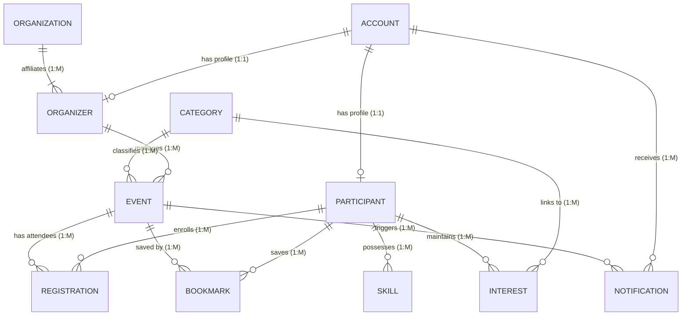

# 🎓 UniScout: Event & Opportunity Management System

[](https://www.unisza.edu.my)
[](https://www.unisza.edu.my)
[](#-team--contributors-group-sentry)
[](database/README.md)
[](#)

> **UniScout** is a centralized campus event and co-curricular opportunity ecosystem designed for **Universiti Sultan Zainal Abidin (UniSZA)**. It streamlines student participation, provides verified university organizers with powerful management and analytics tools, and bridges campus clubs, student associations, and faculties.

---

## 📌 Project Overview

Traditional campus event dissemination relies on fragmented messaging channels, leading to missed application deadlines, low turnouts, and administrative overhead. **UniScout** solves this through a unified digital platform featuring:

- **Centralized Event Discovery**: Filter opportunities by faculty, category, event mode (Physical, Online, Hybrid), and eligibility.
- **Student Profile & Competency Matching**: Match students to campus events and leadership roles based on interests and verified skill sets.
- **Automated Registration Workflows**: Instant registration with structured reference codes, capacity management, and deadline enforcement.
- **Organizer Verification & Oversight**: Controlled authorization tiers for campus clubs, student representatives, and university bodies.
- **Real-Time Notification System**: Targeted announcements for status changes, event reminders, and registration approvals.

---

## 🗂️ Repository Structure

```text
Software-Development-Workshop/
├── .gitignore                               # Standardized OS, environment, and editor ignores
├── README.md                                # Root project documentation and setup guide
│
├── Software-Requirement-Specification/      # SRS Documentation
│   └── UniScout_SRS_Final.pdf               # Final IEEE-compliant SRS specification
│
├── Software-Design-Description/             # SDD Documentation & Guidelines
│   ├── Guideline SDD v1.2.pdf               # Faculty SDD writing guidelines
│   └── Software Design Description (...).pdf# Reference model & format sample
│
└── database/                                # Relational Database Layer
    ├── README.md                            # Complete schema breakdown & MySQL Workbench guide
    ├── uniscout_schema.sql                  # Production DDL script (11 entities, indexes, constraints)
    └── uniscout_seed.sql                    # Realistic sample fixtures (UniSZA faculties, test data)
```

---

## 🗄️ Relational Database Architecture

The relational persistence layer is designed with **domain-prefixed surrogate keys** (e.g. `ACC-1001`, `EVT-2026-001`) to protect against Insecure Direct Object References (IDOR) and ensure auditability across logs, QR registration slips, and reports.



For full entity dictionary, primary key matrix, and step-by-step MySQL Workbench EER diagram generation, refer to the [Database Setup Guide](database/README.md).

---

## 🚀 Quick Start: Database Setup

### Prerequisites
- **MySQL Server 8.0+** or **MariaDB 10.4+**
- **MySQL Workbench** or command line client

### 1. Initialize Schema & Test Data via Terminal
```bash
# Navigate to database directory
cd database

# Run schema creation (creates `uniscout_db` and all 11 tables)
mysql -u root -p < uniscout_schema.sql

# Seed initial test data (categories, organizations, users, events)
mysql -u root -p uniscout_db < uniscout_seed.sql
```

### 2. Or Execute via MySQL Workbench
1. Open MySQL Workbench and connect to your local MySQL connection.
2. Go to **File** ➔ **Open SQL Script...** and run [`database/uniscout_schema.sql`](database/uniscout_schema.sql).
3. Open and run [`database/uniscout_seed.sql`](database/uniscout_seed.sql).
4. Reverse-engineer the visual EER diagram via **Database** ➔ **Reverse Engineer...** (`Cmd+R` / `Ctrl+R`).

---

## 👥 Team & Contributors (Group Sentry)

Developed for **CSD34103 Software Development Workshop**, Faculty of Informatics & Computing (FIK), Universiti Sultan Zainal Abidin (UniSZA).

| Role / Responsibility | Name | Matric / Contact |
| :--- | :--- | :--- |
| **Project Lead / Full-Stack** | Adam Hariz | adamhariz325@gmail.com |
| **Team Member** | Group Sentry Member | UniSZA FIK |
| **Team Member** | Group Sentry Member | UniSZA FIK |
| **Team Member** | Group Sentry Member | UniSZA FIK |

---

## 🌿 Git Branching & Collaboration Guidelines

To maintain clean repository history within Group Sentry:

1. **`main`** branch is protected: only tested, reviewed code and finalized documentation should be merged here.
2. Create dedicated branches for your tasks:
   - Features: `git checkout -b feat/event-filter`
   - Database: `git checkout -b db/add-attendance-table`
   - Documentation: `git checkout -b docs/sdd-section-3`
   - Bugfixes: `git checkout -b fix/registration-deadline`
3. Write clean, conventional commit messages:
   - `feat: implement user registration endpoint`
   - `fix: resolve foreign key constraint in registration table`
   - `docs: update SDD class diagram in Chapter 4`
4. Always pull before pushing: `git pull origin main --rebase`

---

## 📄 License & Academic Integrity

This project is developed for academic evaluation under **UniSZA CSD34103 Software Development Workshop**. All rights reserved by **Group Sentry** and Universiti Sultan Zainal Abidin.
