# CHAPTER 3: DETAILED DESIGN

**System:** UniScout: Event & Opportunity Management System  
**Course:** CSD34103 Software Development Workshop  
**Document:** Software Design Description (SDD) [v1.2]  
**Faculty:** Faculty of Informatics and Computing (FIK), Universiti Sultan Zainal Abidin (UniSZA)  
**Team:** Group Sentry  

---

## 3.0 Process Decomposition & Traceability Matrix (Follows Figure 2.3)

### 3.0.1 Authoritative Process Decomposition Tree (Figure 2.3)

In strict accordance with the system specification established in **Figure 2.3: Process Decomposition** (`UniScout_Process_Decomposition.png`), the functional architecture of UniScout is decomposed into actor-based domain workflows (Participant, Organizer, Administrator) alongside global system utilities (Manage User Accounts, Manage Notifications):

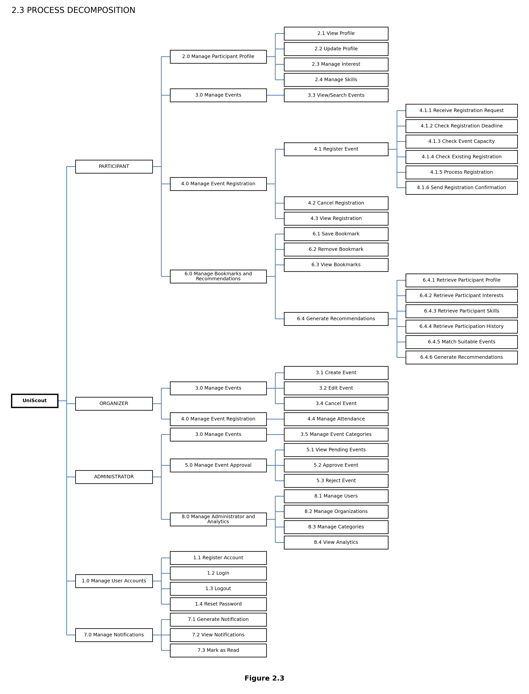

```text
================================================================================
UNISCOUT PROCESS DECOMPOSITION HIERARCHY (EXACT MAPPING TO FIGURE 2.3)
================================================================================
UniScout
|
|-- PARTICIPANT
|   |-- 2.0 Manage Participant Profile
|   |   |-- 2.1 View Profile
|   |   |-- 2.2 Update Profile
|   |   |-- 2.3 Manage Interest
|   |   +-- 2.4 Manage Skills
|   |
|   |-- 3.0 Manage Events
|   |   +-- 3.3 View/Search Events
|   |
|   |-- 4.0 Manage Event Registration
|   |   |-- 4.1 Register Event
|   |   |   |-- 4.1.1 Receive Registration Request
|   |   |   |-- 4.1.2 Check Registration Deadline
|   |   |   |-- 4.1.3 Check Event Capacity
|   |   |   |-- 4.1.4 Check Existing Registration
|   |   |   |-- 4.1.5 Process Registration
|   |   |   +-- 4.1.6 Send Registration Confirmation
|   |   |-- 4.2 Cancel Registration
|   |   +-- 4.3 View Registration
|   |
|   +-- 6.0 Manage Bookmarks and Recommendations
|       |-- 6.1 Save Bookmark
|       |-- 6.2 Remove Bookmark
|       |-- 6.3 View Bookmarks
|       +-- 6.4 Generate Recommendations
|           |-- 6.4.1 Retrieve Participant Profile
|           |-- 6.4.2 Retrieve Participant Interests
|           |-- 6.4.3 Retrieve Participant Skills
|           |-- 6.4.4 Retrieve Participation History
|           |-- 6.4.5 Match Suitable Events
|           +-- 6.4.6 Generate Recommendations
|
|-- ORGANIZER
|   |-- 3.0 Manage Events
|   |   |-- 3.1 Create Event
|   |   |-- 3.2 Edit Event
|   |   +-- 3.4 Cancel Event
|   |
|   +-- 4.0 Manage Event Registration
|       +-- 4.4 Manage Attendance
|
|-- ADMINISTRATOR
|   |-- 3.0 Manage Events
|   |   +-- 3.5 Manage Event Categories
|   |
|   |-- 5.0 Manage Event Approval
|   |   |-- 5.1 View Pending Events
|   |   |-- 5.2 Approve Event
|   |   +-- 5.3 Reject Event
|   |
|   +-- 8.0 Manage Administrator and Analytics
|       |-- 8.1 Manage Users
|       |-- 8.2 Manage Organizations
|       |-- 8.3 Manage Categories
|       +-- 8.4 View Analytics
|
|-- 1.0 Manage User Accounts
|   |-- 1.1 Register Account
|   |-- 1.2 Login
|   |-- 1.3 Logout
|   +-- 1.4 Reset Password
|
+-- 7.0 Manage Notifications
    |-- 7.1 Generate Notification
    |-- 7.2 View Notifications
    +-- 7.3 Mark as Read
================================================================================
```

---

### 3.0.2 Master Process-to-GUI Traceability Matrix

Every process in Figure 2.3 is mapped to its corresponding graphical user interface, configuration code, and interactive prototype view:

| Process ID | Process Name (as in Figure 2.3) | Domain Actor | Data Stores | GUI Config ID | Prototype View / Modal ID | Reference Figure |
| :--- | :--- | :--- | :--- | :--- | :--- | :--- |
| **1.1, 1.2** | Register Account / Login | Shared / Global | D1, D2, D3 | — | Standard Authentication | Handled via SSO |
| **1.3, 1.4** | Logout / Reset Password | Shared / Global | D1, D12 | `GUI-SEC-01` | `#view-settings` | [Figure 3.12](figures/fig_3_12_account_security.png) |
| **2.1, 2.3, 2.4** | View Profile / Manage Interest / Manage Skills | Participant | D2, D7, D10, D11 | `GUI-PROF-01` | `#view-profile` | [Figure 3.4](figures/fig_3_4_participant_profile.png) |
| **2.2** | Update Profile | Participant | D2 | `GUI-PROF-02` | `#edit-profile-modal` | [Figure 3.5](figures/fig_3_5_edit_profile_modal.png) |
| **3.3** | View/Search Events | Participant | D5, D6, D8 | `GUI-CAL-01`, `GUI-CAL-02` | `#view-calendar` | [Figure 3.1](figures/fig_3_1_calendar_interface.png), [Figure 3.2](figures/fig_3_2_calendar_modal.png) |
| **4.1 (4.1.1–4.1.6)** | Register Event | Participant | D5, D8, D14 | `GUI-CAL-02`, `GUI-CAL-03` | `#calendar-event-modal`, `#fast-pass-modal` | [Figure 3.2](figures/fig_3_2_calendar_modal.png), [Figure 3.3](figures/fig_3_3_fast_pass_modal.png) |
| **4.2** | Cancel Registration | Participant | D5, D8 | `GUI-REG-02` | `#cancel-reg-modal` | [Figure 3.7](figures/fig_3_7_cancel_registration_dialog.png) |
| **4.3** | View Registration | Participant | D8, D10 | `GUI-REG-01`, `GUI-CAL-03` | `#view-registrations` | [Figure 3.6](figures/fig_3_6_my_registrations.png) |
| **6.1, 6.2, 6.3** | Save / Remove / View Bookmarks | Participant | D5, D9 | `GUI-BOOK-01` | `#view-saved` | [Figure 3.10](figures/fig_3_10_saved_opportunities.png) |
| **6.4 (6.4.1–6.4.6)** | Generate Recommendations | Participant | D2, D5, D10, D11 | `GUI-REC-01` | `#view-recommendations` | [Figure 3.8](figures/fig_3_8_recommendations_feed.png) |
| **3.1, 3.2, 3.4** | Create / Edit / Cancel Event | Organizer | D3, D5, D8 | `GUI-ORG-01`, `GUI-ORG-02` | `#view-organizer`, `#create-event-modal` | [Figure 3.13](figures/fig_3_13_organizer_studio.png), [Figure 3.15](figures/fig_3_15_create_event_modal.png) |
| **4.4** | Manage Attendance | Organizer | D8, D10 | `GUI-ATT-01` | `#attendance-roster-modal` | [Figure 3.16](figures/fig_3_16_attendance_roster_modal.png) |
| **3.5** | Manage Event Categories | Administrator | D6 | `GUI-ADMIN-01` | `#view-admin` (`#tab-categories`) | [Figure 3.14](figures/fig_3_14_admin_analytics.png) |
| **5.1, 5.2, 5.3** | View Pending / Approve / Reject Event | Administrator | D4, D5, D14 | `GUI-APPR-01` | `#view-approval` | [Figure 3.9](figures/fig_3_9_event_approval_dashboard.png) |
| **8.1, 8.2, 8.3, 8.4**| Manage Users / Organizations / Categories / Analytics| Administrator | D1, D3, D5, D13 | `GUI-ADMIN-01` | `#view-admin` | [Figure 3.14](figures/fig_3_14_admin_analytics.png) |
| **7.1, 7.2, 7.3** | Generate / View / Mark Read Notifications | Shared / Global | D14 | `GUI-NOTIF-01` | `#view-notifications` | [Figure 3.11](figures/fig_3_11_notification_center.png) |

---

## 3.1 SECTION 1: GLOBAL PROCESSES (MANAGE USER ACCOUNTS)

### 3.1.1 Process 1.0: Manage User Accounts Overview
Process 1.0 governs the lifecycle of user credentials, authentication security, session management, and password recovery across all user categories (Students, Organizers, Administrators). In alignment with lecturer guidelines (*"Dr x nak letak login"*), the graphical user interface detailed in this section focuses on Account Security, Multi-Factor Verification, and Active Session Invalidation (`GUI-SEC-01`).

---

### Process 1.1: Register Account
#### a. Pseudocode
```text
1. Start
2. Make access "Account Registration"
3. Input user registration attributes:
   3.1 Input full_name
   3.2 Input matric_or_staff_id
   3.3 Input institutional_email (@unisza.edu.my or @putra.unisza.edu.my)
   3.4 Input password
   3.5 Input confirm_password
   3.6 Select user_role ('STUDENT', 'ORGANIZER', 'ADMINISTRATOR')
4. Verify institutional_email format and authoritative UniSZA domain
5. Query database D1 (USERS) to verify matric_or_staff_id is not already registered
6. Verify password complexity (min 8 chars, uppercase, lowercase, number, special char)
7. Verify password matches confirm_password
8. If (validation succeeds)
   8.1 Generate unique cryptographic salt
   8.2 Compute password_hash = HASH(password + salt)
   8.3 Insert record into database D1 (USERS)
   8.4 If (user_role == 'STUDENT')
       8.4.1 Insert record into database D2 (PARTICIPANTS)
   8.5 Else If (user_role == 'ORGANIZER')
       8.5.1 Insert record into database D3 (ORGANIZERS) with status 'PENDING_VERIFICATION'
   8.6 Dispatch verification token to institutional_email
   8.7 Display message: "Registration successful. Please verify your email to activate account."
9. Else
   9.1 Display validation error message
10. End
```

---

### Process 1.2: Login
#### a. Pseudocode
```text
1. Start
2. Make access "System Authentication"
3. Input login credentials:
   3.1 Input email_or_matric
   3.2 Input password
4. Retrieve user record from database D1 (USERS) WHERE email = email_or_matric OR matric_no = email_or_matric
5. If (user record found AND account_status == 'ACTIVE')
   5.1 Compute test_hash = HASH(password + user.salt)
   5.2 If (test_hash == user.password_hash)
       5.2.1 Generate cryptographically secure JWT session_token
       5.2.2 Insert record into database D1_SESSIONS (session_token, user_id, device_info, ip_address, login_time)
       5.2.3 Update user.last_login_timestamp in database D1 (USERS)
       5.2.4 Direct user to appropriate workspace (Participant, Organizer, or Administrator)
   5.3 Else
       5.3.1 Increment failed_login_attempts in D1 (USERS)
       5.3.2 If (failed_login_attempts >= 5)
             5.3.2.1 Lock account for 15 minutes
             5.3.2.2 Record incident in database D12 (AUDIT_LOGS)
       5.3.3 Display message: "Invalid email/matric or password."
6. Else If (user record found AND account_status == 'PENDING_VERIFICATION')
   6.1 Display message: "Account pending institutional verification. Contact administrator."
7. Else
   7.1 Display message: "User account not found."
8. End
```

---

### Process 1.3: Logout
#### a. Pseudocode
```text
1. Start
2. User selects "Logout" or navigates to "Settings" -> "Session Management"
3. Select logout scope:
   3.1 Scope A: Terminate current local session
   3.2 Scope B: Terminate all other remote device sessions
4. If (Scope A: Current session)
   4.1 Retrieve active session_token from client request
   4.2 Delete record from database D1_SESSIONS WHERE session_token = current_token
   4.3 Clear client session cookies and storage tokens
   4.4 Record logout event in database D12 (AUDIT_LOGS)
   4.5 Redirect client to UniScout public portal
5. Else If (Scope B: Terminate other remote devices)
   5.1 Retrieve current user_id
   5.2 Delete records from database D1_SESSIONS WHERE user_id = current_user_id AND session_token != current_token
   5.3 Record session revocation in database D12 (AUDIT_LOGS)
   5.4 Display message: "All other device sessions successfully signed out."
   5.5 Refresh active sessions audit rail in UI
6. End
```

---

### Process 1.4: Reset Password
#### a. Pseudocode
```text
1. Start
2. Make access "Settings" -> "Account Security"
3. Select "Change Password"
4. Input password modification credentials:
   4.1 Input current_password
   4.2 Input new_password
   4.3 Input confirm_new_password
5. Query database D1 (USERS) for active user credential record
6. Verify HASH(current_password + user.salt) equals user.password_hash
7. If (current password verification succeeds)
   7.1 Verify new_password meets complexity requirements (>= 8 chars, uppercase, number, symbol)
   7.2 Verify new_password equals confirm_new_password
   7.3 If (validation succeeds)
       7.3.1 Generate fresh cryptographic salt
       7.3.2 Compute new_hash = HASH(new_password + new_salt)
       7.3.3 Update database D1 (USERS) SET password_hash = new_hash, salt = new_salt, last_password_change = CURRENT_TIMESTAMP
       7.3.4 Invalidate all other active remote sessions from database D1_SESSIONS
       7.3.5 Record event in database D12 (AUDIT_LOGS)
       7.3.6 Display message: "Password updated successfully! All other sessions signed out."
   7.4 Else
       7.4.1 Display message: "New password does not satisfy complexity policy or match confirmation."
8. Else
   8.1 Display message: "Current password does not match authoritative records."
9. End
```

---

### b. Flow Chart for Process 1.0 (Account Security & Session Management)

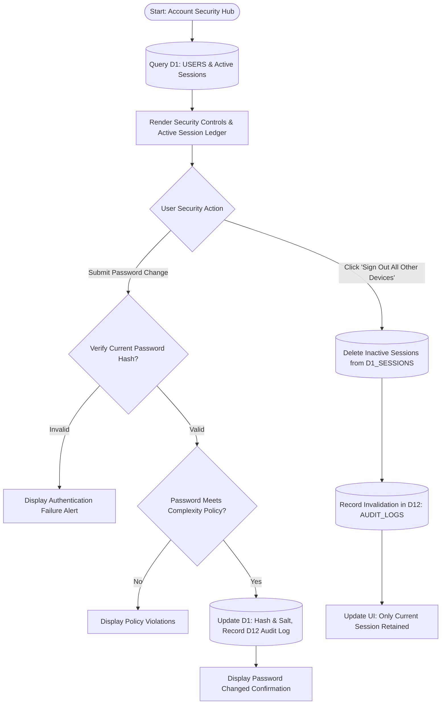

---

### c. Graphic User Interface for Process 1.0

#### Screen 10: Account Security & Password Management Interface
- **Configuration Identification:** `GUI-SEC-01`
- **Reference Image:** [Figure 3.12: Account Security Interface](figures/fig_3_12_account_security.png)

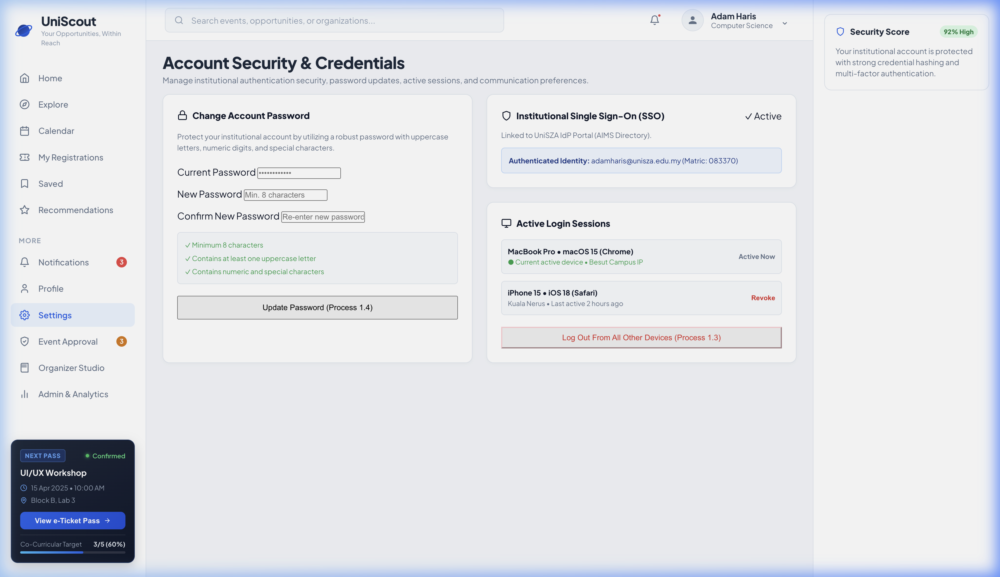

##### Interface Component Specification:
1. **Password Modification Box (`.security-card`):** Inputs for current password, new password with interactive strength meter, 4-point compliance checklist, confirm password, and Update Password button.
2. **Institutional SSO & Two-Factor Authentication Status Card:** Displays verified linkage with UniSZA AIMS/LDAP and active 2FA status.
3. **Active Sessions Audit Rail (`#right-panel-settings`):** Live audit list of logged-in devices and `Sign Out All Other Sessions` kill switch.

---

## 3.2 SECTION 2: PARTICIPANT PROCESSES

### 3.2.1 Process 2.0: Manage Participant Profile Overview
Governs student identity, verified skills competency matrix, institutional academic standing verification, graduation co-curricular merit tracking, and discovery category preferences (`FR-PARTICIPANT-001`, `FR-PARTICIPANT-002`, `FR-PARTICIPANT-003`, `FR-PARTICIPANT-007`).

---

### Process 2.1: View Profile
#### a. Pseudocode
```text
1. Start
2. Make access "Profile" navigation link
3. Retrieve student matricNumber ("083370") from active session
4. Query database D2 (PARTICIPANTS) WHERE matric_no = matricNumber:
   4.1 Retrieve full_name, faculty_name, program_name, cgpa, academic_year, advisor_name, email, phone, github_url, personal_bio
5. Query database D10 (ATTENDANCE) JOIN D5 (EVENTS) ON event_id WHERE matric_no = matricNumber AND attendance_status = 'VERIFIED':
   5.1 Compute total_merits = COUNT(attendance_id)
   5.2 Compute domain_academic_merits   = COUNT WHERE merit_domain = 'Academic & Tech'
   5.3 Compute domain_leadership_merits = COUNT WHERE merit_domain = 'Leadership & Gov'
   5.4 Compute domain_community_merits  = COUNT WHERE merit_domain = 'Community Service'
   5.5 Compute domain_sports_merits     = COUNT WHERE merit_domain = 'Sports & Wellness'
   5.6 Compute completion_percentage    = (total_merits / 5.0) * 100
6. Query database D7 (PARTICIPANT_INTERESTS) WHERE matric_no = matricNumber
7. Query database D11 (SKILLS) WHERE matric_no = matricNumber
8. Query UniSZA AIMS Gateway for Academic Clearance Status:
   8.1 Check matriculation validity
   8.2 Check minimum CGPA threshold (>= 2.00)
   8.3 Check co-curricular merit requirement (total_merits >= 5)
   8.4 Check financial and library outstanding dues
9. Render 3-column Profile Hub (Hero Card, Graduation Merits Progress, Competency Bars, Clearance Checklist Rail)
10. End
```

---

### Process 2.2: Update Profile
#### a. Pseudocode
```text
1. Start
2. Make access "Profile"
3. Click "Edit Profile" button
4. Open Update Participant Profile Dialog Modal (GUI-PROF-02)
5. Display read-only authoritative AIMS fields (Full Legal Name, Matric Number)
6. User enters updated contact information:
   6.1 Input updated_phone
   6.2 Input updated_github_url
   6.3 Input updated_personal_bio
7. If (user clicks "Save Profile Changes")
   7.1 Validate updated_phone conforms to E.164 phone standard
   7.2 Validate updated_github_url is a well-formed URL
   7.3 If (validation passes)
       7.3.1 Update database D2 (PARTICIPANTS) SET phone = updated_phone, github_url = updated_github_url, personal_bio = updated_personal_bio WHERE matric_no = current_matric
       7.3.2 Record update event in database D12 (AUDIT_LOGS)
       7.3.3 Display message: "Profile updated successfully!"
       7.3.4 Close Update Profile Modal
       7.3.5 Re-render profile hero card with updated attributes
   7.4 Else
       7.4.1 Display validation warning message
8. Else If (user clicks "Cancel")
   8.1 Dismiss modal without saving
9. End
```

---

### Process 2.3: Manage Interest
#### a. Pseudocode
```text
1. Start
2. Make access "Profile" -> "Interests & Preferences" card
3. Load current category preferences from database D7 (PARTICIPANT_INTERESTS)
4. Display taxonomy category pills with interactive toggle switches:
   (Workshop, Seminar, Competition, Career, Volunteering, Sports)
5. User toggles a specific category pill checkbox
6. If (checkbox is toggled to CHECKED)
   6.1 Insert record into database D7 (PARTICIPANT_INTERESTS) VALUES (matric_no, category_id, CURRENT_TIMESTAMP)
   6.2 Invalidate cached recommendation feed for participant
   6.3 Display notification: "Category added to discovery preferences."
7. Else If (checkbox is toggled to UNCHECKED)
   7.1 Delete record from database D7 (PARTICIPANT_INTERESTS) WHERE matric_no = matric_no AND category_id = category_id
   7.2 Invalidate cached recommendation feed for participant
   7.3 Display notification: "Category removed from discovery preferences."
8. Update UI toggle state dynamically
9. End
```

---

### Process 2.4: Manage Skills
#### a. Pseudocode
```text
1. Start
2. Make access "Profile" -> "Verified Skills & Competencies" card
3. Load current skills from database D11 (SKILLS) WHERE matric_no = current_matric
4. Display competency bars with proficiency percentages
5. User clicks "+ Add Skill"
6. Prompt user for skill details:
   6.1 Input skill_name
   6.2 Input proficiency_percentage (Integer between 1 and 100)
7. If (skill_name is not empty AND 1 <= proficiency_percentage <= 100)
   7.1 Insert record into database D11 (SKILLS) VALUES (UUID(), current_matric, skill_name, proficiency_percentage, CURRENT_TIMESTAMP)
   7.2 Trigger recommendation engine vector re-calculation
   7.3 Display message: "Skill competency added successfully."
   7.4 Re-render skills list with new animated proficiency bar
8. Else
   8.1 Display error: "Invalid skill name or proficiency rating."
9. End
```

---

### b. Flow Chart for Process 2.0

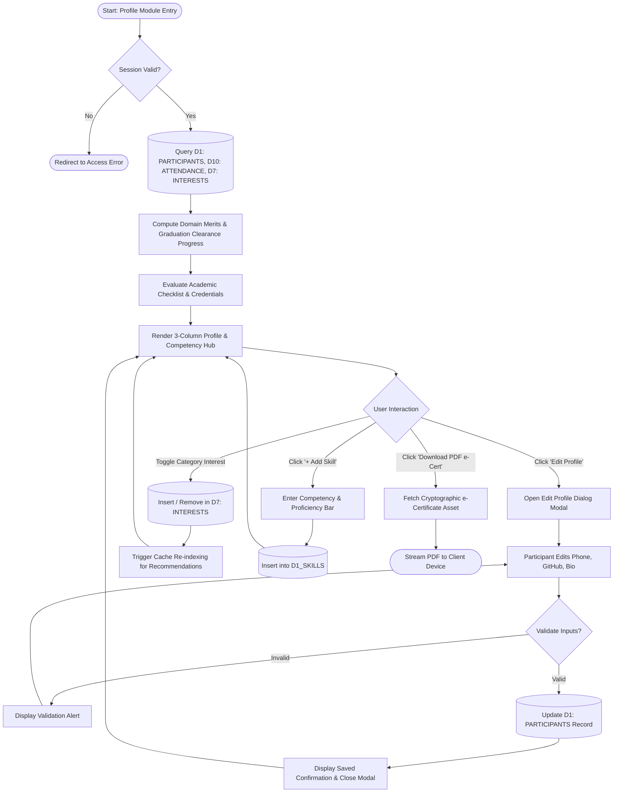

---

### c. Graphic User Interface for Process 2.0

#### Screen 4: Participant Profile & Competency Matrix Hub
- **Configuration Identification:** `GUI-PROF-01`
- **Reference Image:** [Figure 3.4: Participant Profile Interface](figures/fig_3_4_participant_profile.png)

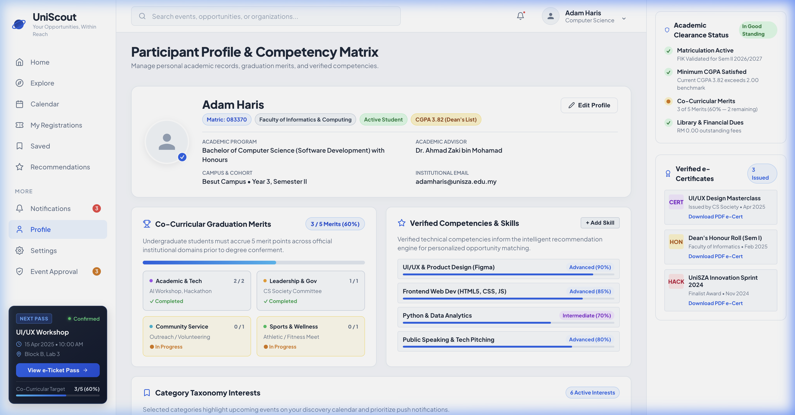

#### Screen 5: Update Participant Profile Modal
- **Configuration Identification:** `GUI-PROF-02`
- **Reference Image:** [Figure 3.5: Edit Profile Modal](figures/fig_3_5_edit_profile_modal.png)

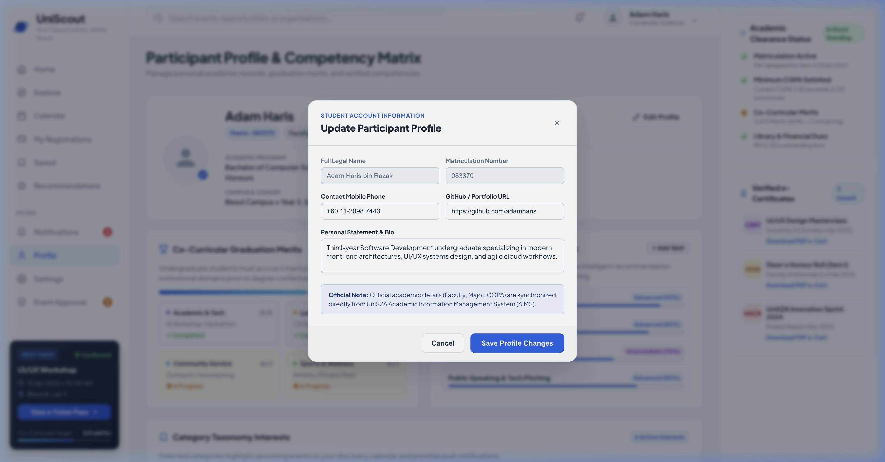

---

### 3.2.2 Process 3.3: View/Search Events (Participant Domain)
#### a. Pseudocode
```text
1. Start
2. Make access "Calendar" navigation link
3. Read UI state parameters:
   3.1 activeMonth (e.g. 4 for April)
   3.2 activeYear (e.g. 2025)
   3.3 checkedCategories (list of selected category filters)
   3.4 searchQuery (text filter from global search bar)
   3.5 activeView ("month", "week", "day")
4. Retrieve approved events from database D5 (EVENTS) WHERE event_status = 'APPROVED'
5. Join with database D6 (CATEGORIES) to retrieve category_name and display_color
6. Join with database D8 (REGISTRATIONS) to compute registered_count and remaining_seats
7. Compute month boundary dates and initialize 35-cell (7x5) daysMatrix
8. For each cell in daysMatrix:
   8.1 Filter events occurring on cell date
   8.2 If (checkedCategories is not empty)
       8.2.1 Exclude events whose category is not in checkedCategories
   8.3 If (searchQuery is not empty)
       8.3.2 Exclude events whose title or venue does not match searchQuery keyword
   8.4 Attach matching event pills with color tokens to day cell
9. Render Right Utility Rail with Mini-Calendar date picker, category filter checkboxes, and top 5 upcoming events
10. On user click event pill:
    10.1 Retrieve full event metadata
    10.2 Open Event Detail Modal (GUI-CAL-02) displaying logistics, description, and "Register Now" action
11. End
```

---

### c. Graphic User Interface for Process 3.3

#### Screen 1: Primary Calendar & Opportunity Discovery Interface
- **Configuration Identification:** `GUI-CAL-01`
- **Reference Image:** [Figure 3.1: Primary Calendar Interface](figures/fig_3_1_calendar_interface.png)

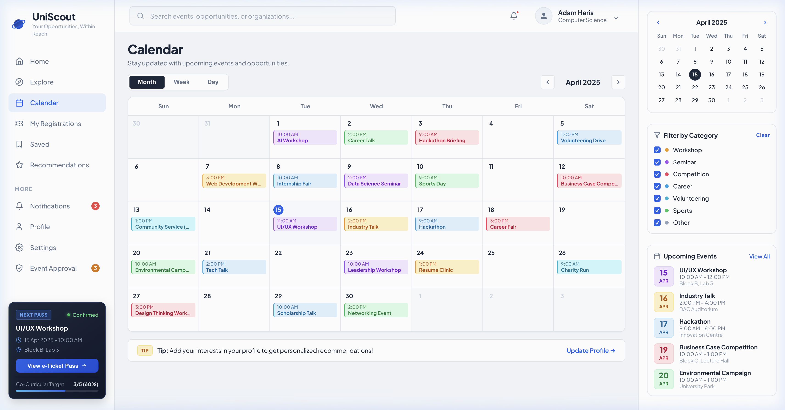

#### Screen 2: Event Detail & Registration Dialog Modal
- **Configuration Identification:** `GUI-CAL-02`
- **Reference Image:** [Figure 3.2: Event Detail Modal](figures/fig_3_2_calendar_modal.png)

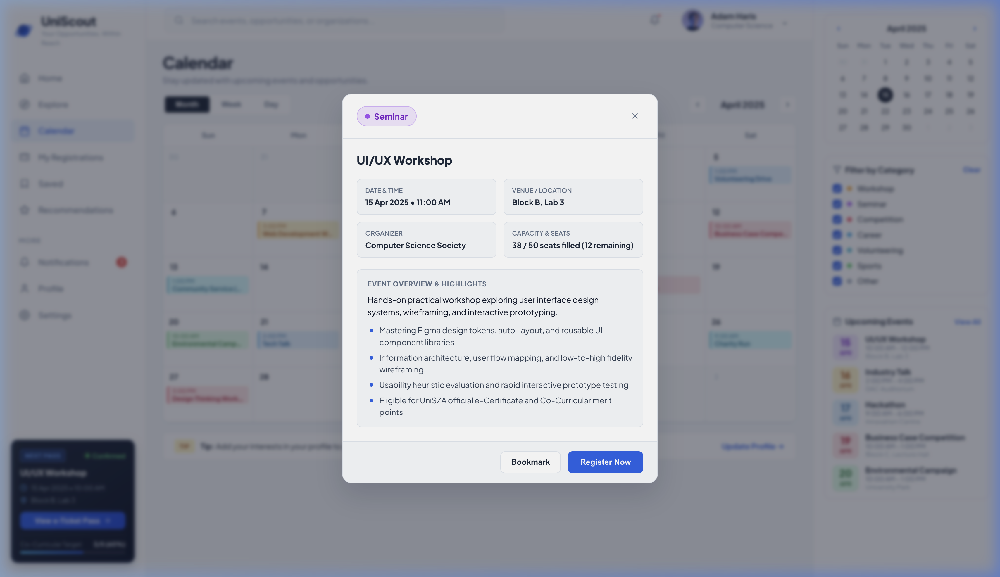

---

### 3.2.3 Process 4.0 (Participant): Manage Event Registration

Governs participant event enrollment, registration validation, pass generation, cancellation, and registration inspection (`FR-PARTICIPANT-006`, `FR-PARTICIPANT-008`, `FR-PARTICIPANT-009`).

---

### Process 4.1: Register Event (Decomposed into Level 3 Sub-Processes 4.1.1 to 4.1.6)

#### Process 4.1.1: Receive Registration Request
```text
1. Start
2. Participant clicks "Register Now" on Event Detail Modal (GUI-CAL-02)
3. Extract registration request parameters:
   3.1 targetEventId
   3.2 participantMatricNo (from active session)
   3.3 requestTimestamp = CURRENT_TIMESTAMP
4. Forward request to Process 4.1.2
5. End
```

#### Process 4.1.2: Check Registration Deadline
```text
1. Start
2. Query database D5 (EVENTS) for targetEventId:
   2.1 Retrieve registration_deadline, event_status
3. If (event_status != 'APPROVED')
   3.1 Display error: "Registration is not open for this event."
   3.2 Terminate registration process
4. If (CURRENT_TIMESTAMP > registration_deadline)
   4.1 Display error: "Registration deadline has passed."
   4.2 Terminate registration process
5. Forward request to Process 4.1.3
6. End
```

#### Process 4.1.3: Check Event Capacity
```text
1. Start
2. Query database D5 (EVENTS) for targetEventId:
   2.1 Retrieve capacity, registered_count
3. Compute available_seats = capacity - registered_count
4. If (available_seats <= 0)
   4.1 Prompt participant: "This event has reached full capacity. Join priority waitlist?"
   4.2 If (confirmed)
       4.2.1 Insert into database D8_WAITLIST (UUID(), targetEventId, participantMatricNo, CURRENT_TIMESTAMP)
       4.2.2 Display message: "You have been placed on the waitlist."
   4.3 Terminate registration process
5. Forward request to Process 4.1.4
6. End
```

#### Process 4.1.4: Check Existing Registration
```text
1. Start
2. Query database D8 (REGISTRATIONS) WHERE matric_no = participantMatricNo AND event_id = targetEventId AND reg_status = 'CONFIRMED'
3. If (existing active registration found)
   3.1 Display error: "You are already registered for this event."
   3.2 Terminate registration process
4. Query database D8 (REGISTRATIONS) JOIN D5 (EVENTS) for participant schedule overlaps
5. If (overlapping confirmed event found)
   5.1 Display warning: "Timetable conflict: You have an existing booking at this timeslot."
   5.2 Terminate registration process
6. Forward request to Process 4.1.5
7. End
```

#### Process 4.1.5: Process Registration
```text
1. Start
2. Generate unique registration voucher reference:
   reg_ref = "REG-" + YEAR() + "-" + RANDOM_HEX(4) (e.g. "REG-2026-4664")
3. Insert record into database D8 (REGISTRATIONS) VALUES (UUID(), targetEventId, participantMatricNo, reg_ref, 'CONFIRMED', CURRENT_TIMESTAMP)
4. Increment registered_count in database D5 (EVENTS) by 1
5. Forward record to Process 4.1.6
6. End
```

#### Process 4.1.6: Send Registration Confirmation
```text
1. Start
2. Generate Fast Check-in Ticket Slip data payload with signed QR token
3. Insert confirmation notification into database D14 (NOTIFICATIONS):
   "Admission pass confirmed for " + event.title + ". Reference: " + reg_ref
4. Update UI button to "Registered!" with green checkmark
5. Automatically open Fast Check-in Ticket Slip Modal (GUI-CAL-03)
6. Display message: "Registration successful! Admission pass generated."
7. End
```

---

### Process 4.2: Cancel Registration
#### a. Pseudocode
```text
1. Start
2. Make access "My Registrations" (GUI-REG-01)
3. Participant clicks "Cancel Booking" on target confirmed registration card
4. Open Registration Cancellation Safety Dialog Modal (GUI-REG-02)
5. Retrieve event start_datetime from database D5 (EVENTS)
6. Verify CURRENT_TIMESTAMP <= (event.start_datetime - 2 HOURS)
7. If (less than 2 hours before event start)
   7.1 Display error: "Late cancellation policy: Bookings cannot be cancelled within 2 hours of session start."
   7.2 Abort
8. Prompt participant to select cancellation_reason from dropdown
9. If (participant clicks "Confirm Cancellation")
   9.1 Update database D8 (REGISTRATIONS) SET reg_status = 'CANCELLED', cancellation_reason = cancellation_reason, cancelled_at = CURRENT_TIMESTAMP WHERE reg_id = targetRegId
   9.2 Decrement registered_count in database D5 (EVENTS) by 1
   9.3 Query database D8_WAITLIST for top student ordered by waitlist_timestamp ASC
   9.4 If (waitlist student found)
       9.4.1 Promote student: Insert record into database D8 (REGISTRATIONS) with status 'CONFIRMED'
       9.4.2 Increment registered_count in database D5 (EVENTS) by 1
       9.4.3 Delete promoted student record from database D8_WAITLIST
       9.4.4 Dispatch urgent notification into database D14 (NOTIFICATIONS) to promoted student: "A seat has opened! You have been promoted to Confirmed for " + event.title
   9.5 Display message: "Booking cancelled successfully. Vacated seat released."
   9.6 Close cancellation dialog and refresh My Registrations list
10. Else
    10.1 Close dialog without modifying registration
11. End
```

---

### Process 4.3: View Registration
#### a. Pseudocode
```text
1. Start
2. Make access "My Registrations" navigation link
3. Retrieve matricNumber from active session
4. Query database D8 (REGISTRATIONS) JOIN D5 (EVENTS) ON event_id WHERE matric_no = matricNumber:
   4.1 Select reg_id, event_title, start_datetime, end_datetime, venue_name, category_name, reg_status, reg_voucher_ref
5. Partition registrations into three view collections:
   5.1 upcomingList = Filter WHERE reg_status = 'CONFIRMED' AND start_datetime >= CURRENT_TIMESTAMP
   5.2 attendedList = Filter WHERE reg_status IN ('ATTENDED', 'VERIFIED')
   5.3 cancelledList = Filter WHERE reg_status LIKE 'CANCELLED%'
6. For each record in attendedList:
   6.1 Query database D10 (ATTENDANCE) to retrieve checkin_timestamp, scanner_id, merit_awarded, certificate_url
7. Render My Registrations screen with segmented tabs ("Upcoming Passes", "Attended & Merits", "Cancelled")
8. If (user clicks "View Pass (QR)" on any upcoming card)
   8.1 Open Fast Check-in Ticket Slip Modal (GUI-CAL-03) with QR verification token and printable ticket slip
9. End
```

---

### c. Graphic User Interface for Process 4.0 (Participant Domain)

#### Screen 3: Fast Check-in Ticket Slip Admission Pass Modal
- **Configuration Identification:** `GUI-CAL-03`
- **Reference Image:** [Figure 3.3: Fast Check-in Ticket Slip Modal](figures/fig_3_3_fast_pass_modal.png)

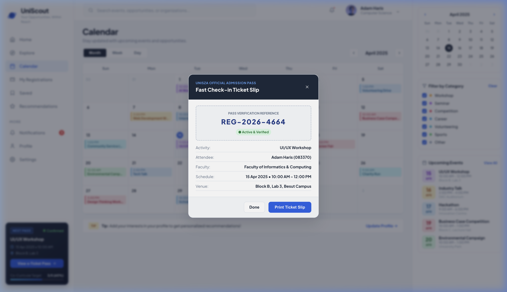

#### Screen 6: My Registrations & Admission Passes Interface
- **Configuration Identification:** `GUI-REG-01`
- **Reference Image:** [Figure 3.6: My Registrations Interface](figures/fig_3_6_my_registrations.png)

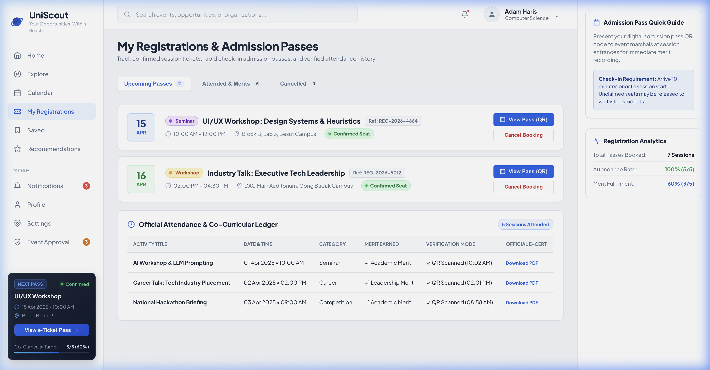

#### Screen 7: Registration Cancellation Dialog Modal
- **Configuration Identification:** `GUI-REG-02`
- **Reference Image:** [Figure 3.7: Cancel Registration Dialog](figures/fig_3_7_cancel_registration_dialog.png)

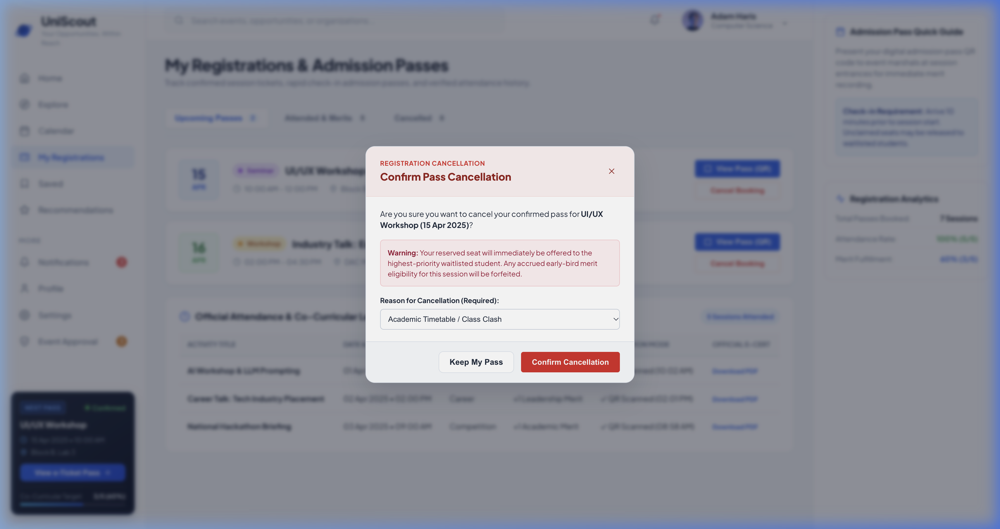

---

### 3.2.4 Process 6.0: Manage Bookmarks and Recommendations

Governs participant bookmark management and executes deterministic machine learning recommendation algorithms based on academic faculty tracks, unfulfilled graduation merits, and verified skill competencies (`FR-PARTICIPANT-004`, `FR-PARTICIPANT-005`, and `FR-SYSTEM-002`).

---

### Process 6.1: Save Bookmark
#### a. Pseudocode
```text
1. Start
2. User clicks "Bookmark" button on any event card or detail modal
3. Retrieve matricNumber from session
4. Query database D9 (BOOKMARKS) WHERE matric_no = matricNumber AND event_id = targetEventId
5. If (bookmark already exists)
   5.1 Display message: "Event already saved in bookmarks."
   5.2 Abort
6. Insert record into database D9 (BOOKMARKS) VALUES (UUID(), matricNumber, targetEventId, CURRENT_TIMESTAMP)
7. Increment saved opportunities count in left navigation badge
8. Update UI button state to "Bookmarked" with solid ribbon icon
9. Display toast message: "Saved to your bookmarks!"
10. End
```

---

### Process 6.2: Remove Bookmark
#### a. Pseudocode
```text
1. Start
2. User clicks "Remove Bookmark" on saved event card (GUI-BOOK-01)
3. Retrieve matricNumber from session
4. Delete record from database D9 (BOOKMARKS) WHERE matric_no = matricNumber AND event_id = targetEventId
5. Decrement saved opportunities count in left navigation badge
6. Animate card fade-out and remove from Saved Opportunities grid
7. Display toast message: "Bookmark removed."
8. End
```

---

### Process 6.3: View Bookmarks
#### a. Pseudocode
```text
1. Start
2. Make access "Saved" navigation link
3. Retrieve matricNumber from session
4. Query database D9 (BOOKMARKS) JOIN D5 (EVENTS) ON event_id WHERE matric_no = matricNumber ORDER BY start_datetime ASC
5. Read active category filter pill selection (e.g. "All", "Workshop", "Seminar")
6. If (category filter != "All")
   6.1 Filter saved events WHERE category_name == selectedCategory
7. Render 3-column Saved Opportunities grid with category badges, date blocks, and quick actions ("Remove Bookmark", "Register Now")
8. Render Right Utility Rail with Saved Summary KPI widget and Deadline Proximity Countdown
9. End
```

---

### Process 6.4: Generate Recommendations (Decomposed into Level 3 Sub-Processes 6.4.1 to 6.4.6)

#### Process 6.4.1: Retrieve Participant Profile
```text
1. Start
2. Retrieve matricNumber ("083370") from active session
3. Query database D2 (PARTICIPANTS) WHERE matric_no = matricNumber:
   3.1 Retrieve faculty_name, program_name, academic_year, cgpa
4. Forward profile data to Process 6.4.2
5. End
```

#### Process 6.4.2: Retrieve Participant Interests
```text
1. Start
2. Query database D7 (PARTICIPANT_INTERESTS) WHERE matric_no = matricNumber:
   2.1 Retrieve list of preferred category_ids
3. Forward preferred categories to Process 6.4.3
4. End
```

#### Process 6.4.3: Retrieve Participant Skills
```text
1. Start
2. Query database D11 (SKILLS) WHERE matric_no = matricNumber:
   2.1 Retrieve list of verified skills {skill_name, proficiency_percentage}
3. Forward skills vector to Process 6.4.4
4. End
```

#### Process 6.4.4: Retrieve Participation History
```text
1. Start
2. Query database D10 (ATTENDANCE) JOIN D5 (EVENTS) WHERE matric_no = matricNumber AND attendance_status = 'VERIFIED':
   2.1 Retrieve list of attended event categories and merit domains
3. Compute unfulfilled graduation merit domains from mandatory set:
   {'Academic & Tech', 'Leadership & Gov', 'Community Service', 'Sports & Wellness'}
4. Forward unfulfilled domains to Process 6.4.5
5. End
```

#### Process 6.4.5: Match Suitable Events
```text
1. Start
2. Query database D5 (EVENTS) WHERE event_status = 'APPROVED' AND start_datetime >= CURRENT_TIMESTAMP
3. Set algorithmic factor weights: weightTrack = 0.40, weightMerit = 0.35, weightSkill = 0.25
4. For each candidate event:
   4.1 Calculate Track Score (40%):
       If (event.target_faculty == participant.faculty_name) scoreTrack = 100
       Else If (event.target_faculty == 'ALL') scoreTrack = 70
       Else scoreTrack = 20
   4.2 Calculate Merit Score (35%):
       If (event.merit_domain IN unfulfilledDomains) scoreMerit = 100
       Else scoreMerit = 40
   4.3 Calculate Skill Score (25%):
       scoreSkill = MAX(participantSkills[req_skill].proficiency_percentage for req_skill in event.prerequisite_skills)
   4.4 Compute composite_score = (scoreTrack * 0.40) + (scoreMerit * 0.35) + (scoreSkill * 0.25)
   4.5 Formulate explicit recommendation rationale based on top matching factor
5. Forward scored events to Process 6.4.6
6. End
```

#### Process 6.4.6: Generate Recommendations
```text
1. Start
2. Sort candidate events by composite_score in descending order
3. Extract top 4 ranked opportunities (High Matches > 85%)
4. Format recommendation cards with category color badge, match percentage pill (98%, 95%), rationale tag, and action triggers
5. Render 2x2 grid on Recommendations View (GUI-REC-01)
6. Render Right Utility Rail with Algorithmic Weighting Preferences distribution panel
7. End
```

---

### c. Graphic User Interface for Process 6.0

#### Screen 8: Personalized Recommendations Feed
- **Configuration Identification:** `GUI-REC-01`
- **Reference Image:** [Figure 3.8: Recommendations Feed](figures/fig_3_8_recommendations_feed.png)

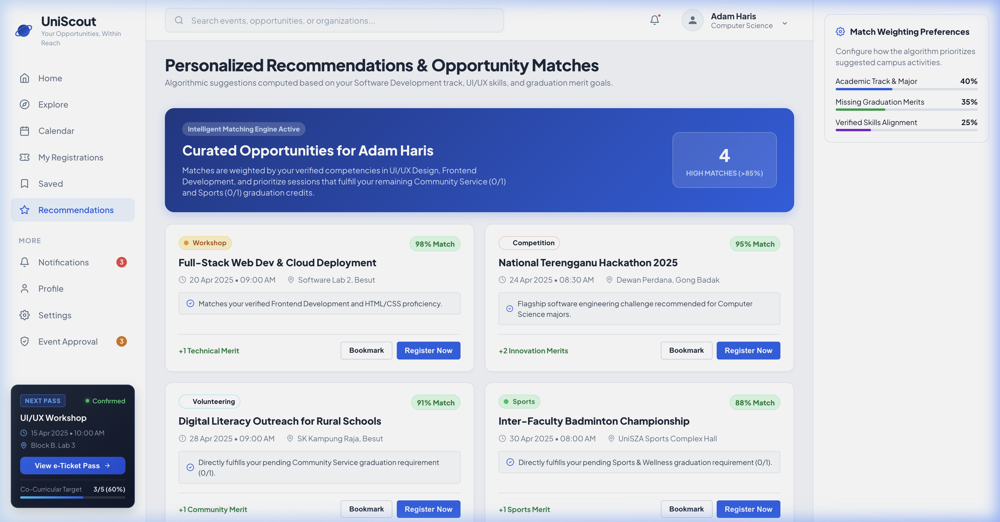

#### Screen 14: Saved Opportunities & Bookmarks Interface
- **Configuration Identification:** `GUI-BOOK-01`
- **Reference Image:** [Figure 3.10: Saved Opportunities Interface](figures/fig_3_10_saved_opportunities.png)

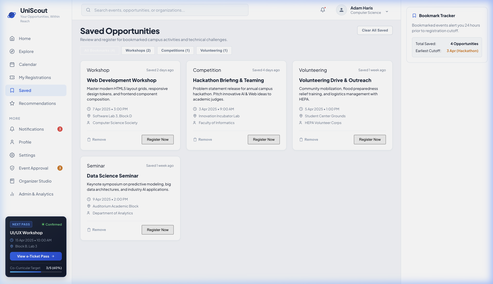

---

## 3.3 SECTION 3: ORGANIZER PROCESSES

### 3.3.1 Process 3.0 (Organizer): Manage Events Overview
Equips campus clubs, societies, and faculty committees with management tools to author event proposals, edit logistics, manage seat capacities, and cancel sessions (`FR-ORGANIZER-001`, `FR-ORGANIZER-003`, `FR-ORGANIZER-004`).

---

### Process 3.1: Create Event
#### a. Pseudocode
```text
1. Start
2. Make access "Organizer Studio"
3. Click "+ Create New Event" button
4. Open Create Event Proposal Dialog Modal (GUI-ORG-02)
5. Load available categories from database D6 (CATEGORIES) into dropdown
6. Load registered campus facilities into venue selector
7. Organizer inputs proposal details:
   7.1 Input event_title
   7.2 Select category_id
   7.3 Select venue_id
   7.4 Input start_datetime
   7.5 Input end_datetime
   7.6 Input capacity_seats
   7.7 Select co_curricular_merit_domain ('Academic', 'Leadership', 'Community', 'Sports')
   7.8 Input event_description
8. If (organizer clicks "Submit Event for Approval")
   8.1 Verify all mandatory fields are provided
   8.2 Verify start_datetime >= (CURRENT_TIMESTAMP + 3 DAYS) for institutional regulatory review lead time
   8.3 Verify end_datetime > start_datetime
   8.4 Verify capacity_seats > 0
   8.5 If (validation passes)
       8.5.1 Generate unique event_id = "EVT-" + YEAR() + "-" + RANDOM_HEX(4)
       8.5.2 Insert record into database D5 (EVENTS) VALUES (event_id, current_org_id, event_title, category_id, venue_id, start_datetime, end_datetime, capacity_seats, 0, 'PENDING', CURRENT_TIMESTAMP)
       8.5.3 Insert notification into database D14 (NOTIFICATIONS) for HEPA Administrators: "New event proposal submitted for approval."
       8.5.4 Display message: "Event proposal submitted successfully for HEPA approval!"
       8.5.5 Close Create Event Modal
       8.5.6 Refresh Organizer Studio listings table
   8.6 Else
       8.6.1 Display validation error message
9. Else If (organizer clicks "Cancel")
   9.1 Close modal without saving proposal
10. End
```

---

### Process 3.2: Edit Event
#### a. Pseudocode
```text
1. Start
2. Make access "Organizer Studio"
3. Select "Edit" on target event row
4. Retrieve event record from database D5 (EVENTS) WHERE event_id = targetEventId
5. Verify current organizer owns the target event
6. If (event.event_status == 'CANCELLED' OR event.start_datetime < CURRENT_TIMESTAMP)
   6.1 Display error: "Cannot edit past or cancelled events."
   6.2 Abort
7. Populate Edit Event Modal with existing event attributes
8. Organizer modifies permitted event details:
   8.1 Modify venue_id
   8.2 Modify start_datetime and end_datetime
   8.3 Modify capacity_seats (must be >= current registered_count)
   8.4 Modify event_description
9. If (organizer clicks "Save Changes")
   9.1 Validate updated inputs
   9.2 Update database D5 (EVENTS) with modified fields
   9.3 If (venue_id OR start_datetime has changed)
       9.3.1 For each confirmed attendee in database D8 (REGISTRATIONS) for targetEventId:
             9.3.1.1 Dispatch urgent reschedule notification into database D14 (NOTIFICATIONS)
   9.4 Display message: "Event details updated successfully."
   9.5 Close modal and refresh Organizer Studio table
10. Else
    10.1 Dismiss modal without updating
11. End
```

---

### Process 3.4: Cancel Event
#### a. Pseudocode
```text
1. Start
2. Make access "Organizer Studio"
3. Select "Cancel" on target event row
4. Open Cancellation Confirmation Dialog Modal
5. Prompt organizer for cancellation_reason
6. If (organizer confirms cancellation)
   6.1 Update database D5 (EVENTS) SET event_status = 'CANCELLED', cancellation_reason = cancellation_reason, cancelled_at = CURRENT_TIMESTAMP WHERE event_id = targetEventId
   6.2 Retrieve all confirmed attendees from database D8 (REGISTRATIONS) WHERE event_id = targetEventId AND reg_status = 'CONFIRMED'
   6.3 For each attendee:
       6.3.1 Update database D8 (REGISTRATIONS) SET reg_status = 'CANCELLED_BY_ORGANIZER'
       6.3.2 Dispatch urgent SMS and push notification into database D14 (NOTIFICATIONS): "Event '" + event.title + "' has been cancelled by the organizer. Details: " + cancellation_reason
   6.4 Update event pill on calendar view to display grey "CANCELLED" tag
   6.5 Display message: "Event cancelled. All enrolled attendees have been notified."
   6.6 Refresh Organizer Studio listings table
7. Else
   7.1 Close cancellation dialog without modifying event
8. End
```

---

### 3.3.2 Process 4.4: Manage Attendance (Organizer Domain)
#### a. Pseudocode
```text
1. Start
2. Organizer accesses "Organizer Studio" -> clicks "Roster" button on target event
3. Open Attendance Roster & Live Verification Modal (GUI-ATT-01)
4. Query database D8 (REGISTRATIONS) JOIN D2 (PARTICIPANTS) WHERE event_id = targetEventId AND reg_status = 'CONFIRMED'
5. Compute checked_in_count = COUNT WHERE checkin_status == 'CHECKED_IN'
6. Display live statistics badge (e.g. "34 / 38 Checked In (89%)")
7. If (method == 'QR_SCAN')
   7.1 Marshal scans student ticket pass voucher token from QR code
   7.2 Verify voucher token exists in confirmed registration list
   7.3 If (token not found)
       7.3.1 Display error: "Invalid voucher token. Student not registered for this session."
       7.3.2 Abort
   7.4 If (attendee already marked 'CHECKED_IN')
       7.4.1 Display warning: "Pass already scanned earlier at " + attendee.checkin_time
       7.4.2 Abort
   7.5 Insert attendance record into database D10 (ATTENDANCE) VALUES (UUID(), attendee.reg_id, targetEventId, attendee.matric_no, CURRENT_TIMESTAMP, 'QR_SCAN', current_scanner_id)
   7.6 Update attendee row in modal to 'Checked In' with timestamp
   7.7 Increment checked_in_count and update percentage
8. Else If (method == 'MANUAL_TOGGLE')
   8.1 Marshal toggles student status switch manually
   8.2 Update database D10 (ATTENDANCE) with method 'MANUAL_OVERRIDE'
   8.3 Update UI roster status
9. If (organizer clicks "Sync Merits to UniSZA AIMS")
   9.1 Assemble cryptographically signed payload of all checked-in matric numbers
   9.2 Transmit payload to UniSZA AIMS Gateway API
   9.3 Update database D10 (ATTENDANCE) SET aims_synced = TRUE, sync_timestamp = CURRENT_TIMESTAMP
   9.4 Display message: "Merits successfully synchronized with UniSZA Academic Information Management System!"
10. End
```

---

### c. Graphic User Interface for Organizer Processes

#### Screen 11: Organizer Studio & Event Operations Management
- **Configuration Identification:** `GUI-ORG-01`
- **Reference Image:** [Figure 3.13: Organizer Studio Interface](figures/fig_3_13_organizer_studio.png)

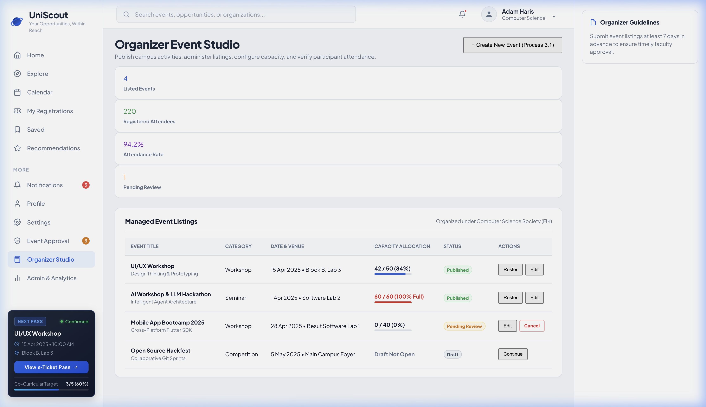

#### Screen 12: Create & Edit Event Modal
- **Configuration Identification:** `GUI-ORG-02`
- **Reference Image:** [Figure 3.15: Create Event Modal](figures/fig_3_15_create_event_modal.png)

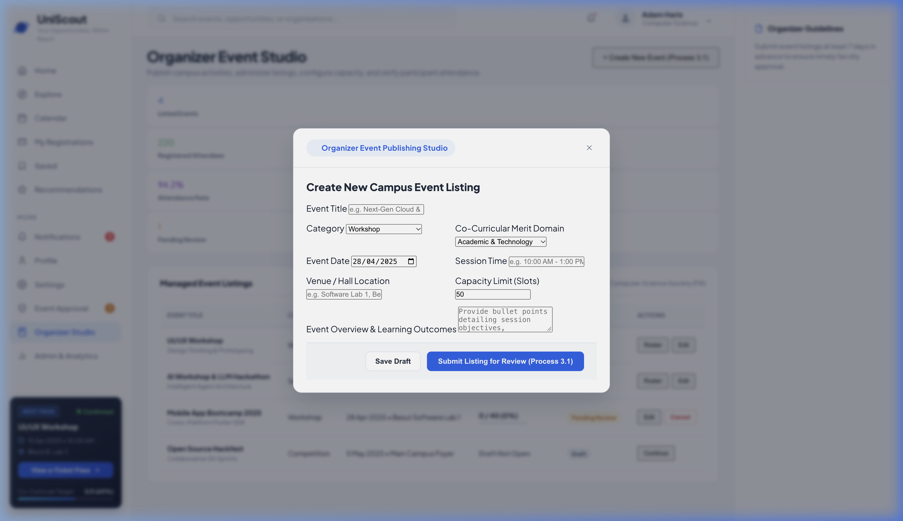

#### Screen 13: Live Attendance Verification & Attendee Roster Modal
- **Configuration Identification:** `GUI-ATT-01`
- **Reference Image:** [Figure 3.16: Attendance Roster Modal](figures/fig_3_16_attendance_roster_modal.png)

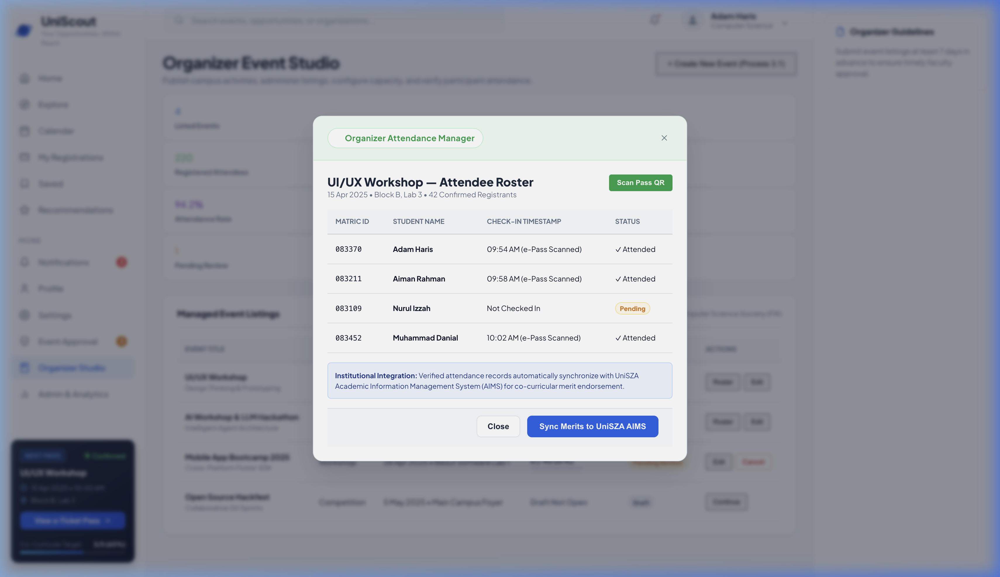

---

## 3.4 SECTION 4: ADMINISTRATOR PROCESSES

### 3.4.1 Process 3.5: Manage Event Categories (Administrator Domain)
#### a. Pseudocode
```text
1. Start
2. Administrator accesses "Admin & Analytics" -> "Category Taxonomy" tab
3. If (action == 'LIST_CATEGORIES')
   3.1 Query database D6 (CATEGORIES) SELECT category_id, category_name, display_color, description
   3.2 Return category list to UI filter rails and creation dropdowns
4. Else If (action == 'CREATE_CATEGORY')
   4.1 Input category_name, display_color, merit_domain_mapping
   4.2 Insert record into database D6 (CATEGORIES)
   4.3 Display message: "New event category added to institutional taxonomy."
5. Else If (action == 'UPDATE_CATEGORY')
   5.1 Update category name, color token, or status in database D6 (CATEGORIES)
   5.2 Invalidate taxonomy cache
6. End
```

---

### 3.4.2 Process 5.0: Manage Event Approval

Equips university administrators (Hal Ehwal Pelajar & Alumni — HEPA, and Faculty Deputy Deans) with governance workflows to review proposals, execute automated venue conflict detection, and authorize calendar publishing (`FR-ADMIN-001`, `FR-ADMIN-002`, `FR-ADMIN-003`).

---

### Process 5.1: View Pending Events
#### a. Pseudocode
```text
1. Start
2. Make access "Event Approval" navigation item (GUI-APPR-01)
3. Verify active administrator privileges in database D4 (ADMINISTRATORS)
4. Query database D5 (EVENTS) WHERE event_status = 'PENDING' ORDER BY created_at ASC
5. Compute executive review statistics:
   5.1 total_proposals = COUNT(event_id)
   5.2 pending_review = COUNT WHERE event_status = 'PENDING'
   5.3 approved_published = COUNT WHERE event_status = 'APPROVED'
   5.4 revisions_required = COUNT WHERE event_status = 'REVISION'
6. For each pending proposal:
   6.1 Query database D5 (EVENTS) for approved events sharing same venue_id
   6.2 Check for timeslot overlaps:
       overlap_count = COUNT WHERE venue_id = proposal.venue_id AND event_status = 'APPROVED' AND timeslots_overlap(start_datetime, end_datetime, proposal.start_datetime, proposal.end_datetime)
   6.3 If (overlap_count == 0)
       6.3.1 Set venue_status = 'VENUE_AVAILABLE' (Green stamp)
   6.4 Else
       6.4.1 Set venue_status = 'CONFLICT_DETECTED' (Red alert)
7. Render Event Approval Dashboard with 4 KPI summary cards, proposals evaluation table, and Campus Venue Radar
8. End
```

---

### Process 5.2: Approve Event
#### a. Pseudocode
```text
1. Start
2. Administrator reviews proposal on Event Approval Dashboard
3. Administrator clicks "Approve" button on target proposal row
4. Verify proposal.venue_status == 'VENUE_AVAILABLE'
5. If (venue conflict detected)
   5.1 Display error: "Cannot approve proposal: Venue scheduling clash detected with an existing approved session. Resolve conflict first."
   5.2 Abort
6. Update database D5 (EVENTS) SET event_status = 'APPROVED', approved_by = current_admin_id, approved_at = CURRENT_TIMESTAMP WHERE event_id = targetEventId
7. Insert notification into database D14 (NOTIFICATIONS) for proposing organizer: "Your event proposal '" + event.title + "' has been approved and published to the campus calendar."
8. Broadcast event listing to Student Discovery Calendar grid
9. Record approval event in database D12 (AUDIT_LOGS)
10. Display message: "Event approved and published to campus calendar!"
11. Refresh dashboard KPI metric counters and proposals table
12. End
```

---

### Process 5.3: Reject Event
#### a. Pseudocode
```text
1. Start
2. Administrator clicks "Reject" button on target proposal row
3. Open Proposal Rejection Feedback Dialog Modal
4. Prompt administrator to input rejection_reason (mandatory regulatory explanation)
5. If (administrator submits rejection)
   5.1 Update database D5 (EVENTS) SET event_status = 'REJECTED', reject_reason = rejection_reason, rejected_at = CURRENT_TIMESTAMP WHERE event_id = targetEventId
   5.2 Insert notification into database D14 (NOTIFICATIONS) for organizer: "Event proposal rejected. Feedback: " + rejection_reason
   5.3 Record rejection event in database D12 (AUDIT_LOGS)
   5.4 Display message: "Proposal rejected. Feedback dispatched to organizer."
   5.5 Refresh approval dashboard table and metrics
6. Else
   6.1 Dismiss modal without updating proposal status
7. End
```

---

### c. Graphic User Interface for Process 5.0

#### Screen 9: Event Approval & Administrative Oversight Dashboard
- **Configuration Identification:** `GUI-APPR-01`
- **Reference Image:** [Figure 3.9: Event Approval Dashboard](figures/fig_3_9_event_approval_dashboard.png)

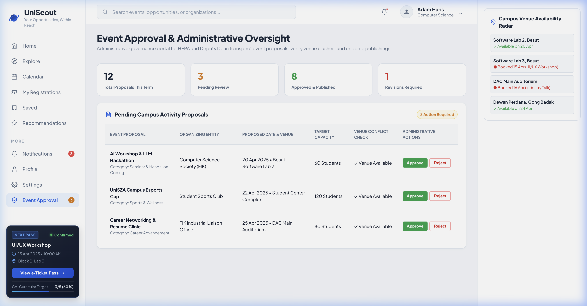

---

### 3.4.3 Process 8.0: Manage Administrator and Analytics

Equips executive university leaders with tools to govern user directories, verify student society accreditations, configure event taxonomies, and view institutional analytics (`FR-ADMIN-004` and `FR-SYSTEM-002`).

---

### Process 8.1: Manage Users
#### a. Pseudocode
```text
1. Start
2. Administrator accesses "Admin & Analytics" -> "User Management" tab
3. Query database D1 (USERS) JOIN D2 (PARTICIPANTS) / D3 (ORGANIZERS) / D4 (ADMINISTRATORS)
4. Filter directory by role dropdown ('ALL', 'STUDENT', 'ORGANIZER', 'ADMINISTRATOR') or search query
5. Display searchable user table with columns: Name, Matric/Staff ID, Role, Status, Actions
6. If (administrator clicks "Edit Role")
   6.1 Prompt for updated role assignment
   6.2 Update database D1 (USERS) SET role = new_role WHERE user_id = targetUserId
   6.3 Record modification in database D12 (AUDIT_LOGS)
   6.4 Display message: "User role updated successfully."
7. Else If (administrator clicks "Suspend Account")
   7.1 Update database D1 (USERS) SET account_status = 'SUSPENDED' WHERE user_id = targetUserId
   7.2 Invalidate all active sessions in database D1_SESSIONS for targetUserId
   7.3 Record suspension in database D12 (AUDIT_LOGS)
   7.4 Display message: "User account suspended and active sessions revoked."
8. Refresh user directory table
9. End
```

---

### Process 8.2: Manage Organizations
#### a. Pseudocode
```text
1. Start
2. Administrator accesses "Admin & Analytics" -> "Organization Directory" tab
3. Query database D3 (ORGANIZERS) SELECT org_id, org_name, faculty_affiliation, registration_code, status, representative_email
4. Display student society accreditation roster
5. If (administrator clicks "Verify Organization")
   5.1 Update database D3 (ORGANIZERS) SET status = 'VERIFIED', verified_by = current_admin_id, verified_at = CURRENT_TIMESTAMP WHERE org_id = targetOrgId
   5.2 Dispatch notification into database D14 (NOTIFICATIONS) to club executive committee: "Organization accreditation verified. You may now publish campus events."
   5.3 Display message: "Student organization successfully verified."
6. Else If (administrator clicks "Suspend")
   6.1 Update database D3 (ORGANIZERS) SET status = 'SUSPENDED' WHERE org_id = targetOrgId
   6.2 Suspend all active event proposals authored by organization
7. Refresh organization directory table
8. End
```

---

### Process 8.3: Manage Categories
#### a. Pseudocode
```text
1. Start
2. Administrator accesses "Admin & Analytics" -> "Category Taxonomy" tab
3. Query database D6 (CATEGORIES) SELECT category_id, category_name, display_color, merit_domain_mapping, weight
4. Display category taxonomy configuration matrix
5. If (administrator updates category weighting or color token)
   5.1 Validate color token hex format (e.g. #FEF3C7)
   5.2 Update database D6 (CATEGORIES) SET display_color = new_color, weight = new_weight WHERE category_id = targetCategoryId
   5.3 Trigger global cache invalidation for calendar discovery pills
   5.4 Display message: "Category taxonomy and color tokens updated successfully."
6. End
```

---

### Process 8.4: View Analytics
#### a. Pseudocode
```text
1. Start
2. Administrator accesses "Admin & Analytics" -> "Analytics & Metrics" tab (GUI-ADMIN-01)
3. Verify administrator credentials in database D4 (ADMINISTRATORS)
4. Compute executive institutional participation metrics:
   4.1 total_registered_students = COUNT(D1) WHERE role = 'STUDENT'
   4.2 active_student_societies = COUNT(D3) WHERE status = 'VERIFIED'
   4.3 total_campus_events = COUNT(D5) WHERE academic_term = currentTerm
   4.4 overall_attendance_rate = (COUNT(D10: 'VERIFIED') / COUNT(D8: 'CONFIRMED')) * 100
5. Query cross-faculty student engagement breakdown:
   SELECT faculty_name, COUNT(attendance_id) AS attendee_volume FROM D10 JOIN D1 ON D10.matric_no = D1.matric_no GROUP BY faculty_name
6. Render 4 Executive KPI metric cards, faculty participation bar chart visualizer, and user governance directory table
7. If (administrator clicks "Download Official HEPA Report")
   7.1 Assemble aggregated attendance statistics and accreditation audit ledger
   7.2 Generate cryptographically signed PDF document
   7.3 Stream official compliance report binary to client browser
8. End
```

---

### c. Graphic User Interface for Process 8.0

#### Screen 16: Administration & University Analytics Dashboard
- **Configuration Identification:** `GUI-ADMIN-01`
- **Reference Image:** [Figure 3.14: Admin Analytics Dashboard](figures/fig_3_14_admin_analytics.png)

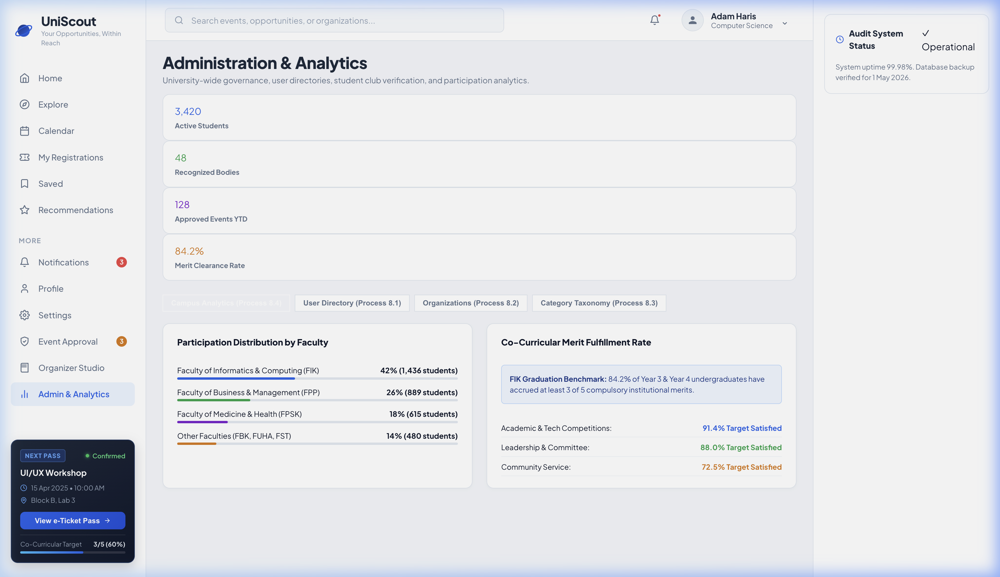

---

## 3.5 SECTION 5: GLOBAL SYSTEM NOTIFICATIONS

### 3.5.1 Process 7.0: Manage Notifications Overview
Manages dispatching, delivery preferences, read status tracking, and multi-channel synchronization for institutional notifications (`FR-SYSTEM-004`).

---

### Process 7.1: Generate Notification
#### a. Pseudocode
```text
1. Start
2. Input notification parameters:
   2.1 recipient_id
   2.2 notification_title
   2.3 notification_message
   2.4 notification_type ('PASS_CONFIRMED', 'VENUE_CHANGE', 'WAITLIST_PROMOTED', 'APPROVAL', 'SYSTEM')
   2.5 target_action_url
3. Generate unique notif_id = UUID()
4. Insert record into database D14 (NOTIFICATIONS) VALUES (notif_id, recipient_id, notification_title, notification_message, notification_type, FALSE, CURRENT_TIMESTAMP, target_action_url)
5. Push real-time WebSocket event to active client session
6. Increment unread counter badge on client top header and left navigation bar
7. End
```

---

### Process 7.2: View Notifications
#### a. Pseudocode
```text
1. Start
2. Make access "Notifications" navigation item (GUI-NOTIF-01)
3. Retrieve current user_id from session
4. Query database D14 (NOTIFICATIONS) WHERE recipient_id = current_user_id ORDER BY created_at DESC
5. Compute unread_count = COUNT WHERE is_read == FALSE
6. Update navigation counter badge with unread_count
7. Read active filter tab selection ("All Notifications", "Unread", "System Announcements")
8. Filter notification cards according to selected tab
9. Render chronological notification feed with high-contrast channel icons, timestamps, and blue unread dot indicators
10. Render Right Utility Sidebar with Notification Delivery Preferences (Push, Email, SMS)
11. End
```

---

### Process 7.3: Mark as Read
#### a. Pseudocode
```text
1. Start
2. If (user clicks individual notification card)
   2.1 Update database D14 (NOTIFICATIONS) SET is_read = TRUE WHERE notif_id = clickedNotifId
   2.2 Remove unread blue dot indicator from card
   2.3 Decrement unread counter badge in navigation
   2.4 If (notification.action_url is not empty)
       2.4.1 Route client to target screen (e.g. Fast Check-in Ticket Slip modal)
3. Else If (user clicks "Mark All as Read" button)
   3.1 Update database D14 (NOTIFICATIONS) SET is_read = TRUE WHERE recipient_id = current_user_id AND is_read = FALSE
   3.2 Remove all unread indicators from feed
   3.3 Reset unread counter badge in navigation to 0
   3.4 Display toast message: "All notifications marked as read."
4. End
```

---

### c. Graphic User Interface for Process 7.0

#### Screen 15: Multi-Channel Notification Center
- **Configuration Identification:** `GUI-NOTIF-01`
- **Reference Image:** [Figure 3.11: Notification Center Interface](figures/fig_3_11_notification_center.png)

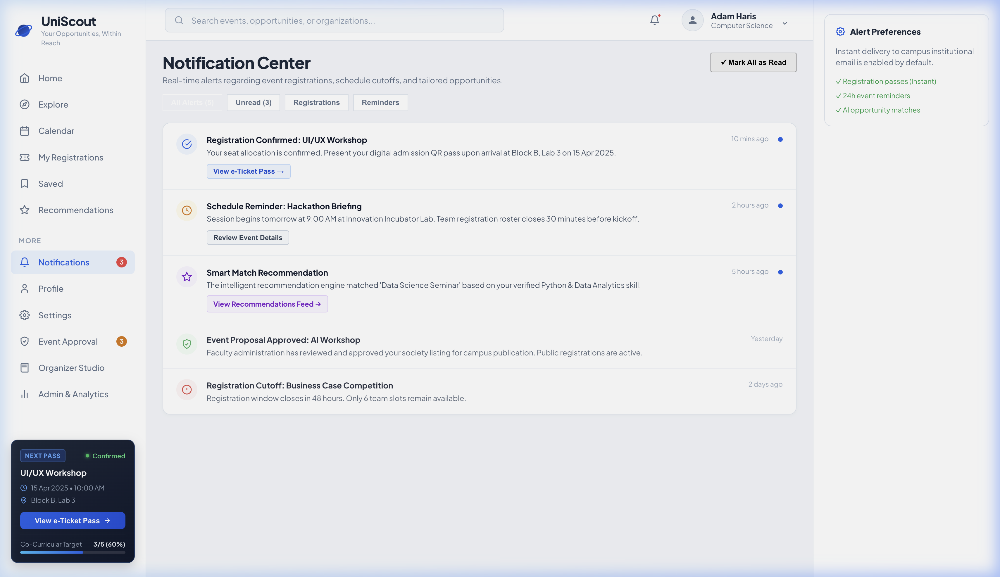

---

## 3.6 Complete Summary of Chapter 3 Implementation Artifacts

All sixteen graphical user interfaces detailed in this chapter are derived from an active, production-grade interactive prototype developed using HTML5, Vanilla CSS3 (Orbit Design System), and JavaScript. Every single process from **Figure 2.3** (`UniScout_Process_Decomposition.png`) is fully mapped:

| Figure Reference | Configuration ID | DFD Process ID (Figure 2.3) | Process Name | Domain Actor |
| :--- | :--- | :--- | :--- | :--- |
| **Figure 3.1** | `GUI-CAL-01` | 3.3 | View/Search Events (Monthly Grid) | Participant |
| **Figure 3.2** | `GUI-CAL-02` | 3.3, 4.1 | View Event Details & Initiate Registration | Participant |
| **Figure 3.3** | `GUI-CAL-03` | 4.1, 4.3 | Fast Check-in Ticket Slip (Admission Pass) | Participant |
| **Figure 3.4** | `GUI-PROF-01` | 2.1, 2.3, 2.4 | View Profile, Manage Interest, Manage Skills | Participant |
| **Figure 3.5** | `GUI-PROF-02` | 2.2 | Update Profile | Participant |
| **Figure 3.6** | `GUI-REG-01` | 4.3 | View Registration & Attendance Passes | Participant |
| **Figure 3.7** | `GUI-REG-02` | 4.2 | Cancel Registration | Participant |
| **Figure 3.8** | `GUI-REC-01` | 6.4 (6.4.1–6.4.6) | Generate Recommendations | Participant |
| **Figure 3.9** | `GUI-APPR-01` | 5.1, 5.2, 5.3 | View Pending Events / Approve / Reject Event | Administrator |
| **Figure 3.10** | `GUI-BOOK-01` | 6.1, 6.2, 6.3 | Save / Remove / View Bookmarks | Participant |
| **Figure 3.11** | `GUI-NOTIF-01` | 7.1, 7.2, 7.3 | Generate / View / Mark as Read Notifications | Shared / Global |
| **Figure 3.12** | `GUI-SEC-01` | 1.3, 1.4 | Logout / Reset Password (Account Security) | Shared / Global |
| **Figure 3.13** | `GUI-ORG-01` | 3.1, 3.2, 3.4 | Create / Edit / Cancel Event (Organizer Studio)| Organizer |
| **Figure 3.14** | `GUI-ADMIN-01` | 3.5, 8.1 - 8.4 | Manage Categories / Users / Organizations / Analytics | Administrator |
| **Figure 3.15** | `GUI-ORG-02` | 3.1, 3.2 | Create Event / Edit Event Modal | Organizer |
| **Figure 3.16** | `GUI-ATT-01` | 4.4 | Manage Attendance (Live Roster & QR Verification)| Organizer |

---

### Local Prototype Execution
The interactive prototype encompassing all screens above can be executed locally:
```bash
cd Software-Design-Description/prototypes/event-discovery
python3 -m http.server 8192

# In browser:
http://localhost:8192
```
