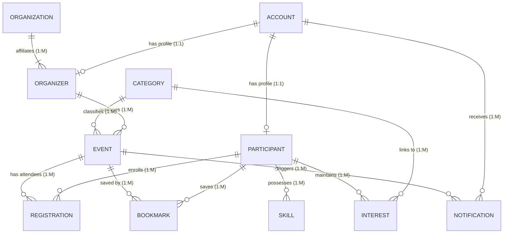

# UniScout Database Schema & MySQL Workbench Setup Guide

This folder contains the complete, production-ready MySQL DDL schema and seed dataset for **UniScout: Event and Opportunity Management System** (CSD34103 Software Development Workshop - Group Sentry, UniSZA).

---

## 📁 Files in this Directory

| File | Description |
| :--- | :--- |
| [`uniscout_schema.sql`](file:///Users/adam/Desktop/Software-Development-Workshop/database/uniscout_schema.sql) | Complete DDL script creating `uniscout_db` with all 11 tables, constraints, foreign keys, checks, and performance indexes. |
| [`uniscout_seed.sql`](file:///Users/adam/Desktop/Software-Development-Workshop/database/uniscout_seed.sql) | Realistic fixture records matching UniSZA faculties, Group Sentry participants, categories, events, and notifications. |

---

## 🗄️ Relational Entities Overview (SRS Chapter 3.4)



### Table Summary:
1. **`ACCOUNT`**: Centralized authentication (`account_id`, `email`, `password_hash`, `role`, `account_status`, `created_at`).
2. **`PARTICIPANT`**: Student profile (`participant_id`, `account_id`, `participant_code`, `full_name`, `faculty`, `program`, `academic_year`, `phone_no`).
3. **`ORGANIZATION`**: University bodies/clubs (`organization_id`, `org_name`, `org_type`, `description`, `contact_email`, `verification_status`).
4. **`ORGANIZER`**: Organization representative (`organizer_id`, `account_id`, `organization_id`, `full_name`, `position`, `phone_no`).
5. **`CATEGORY`**: Event domains (`category_id`, `category_name`, `description`, `category_status`).
6. **`EVENT`**: Published/pending event listings (`event_id`, `organizer_id`, `category_id`, `title`, `description`, `event_mode`, `location`, `start_datetime`, `end_datetime`, `reg_deadline`, `capacity`, `eligibility_criteria`, `event_status`, `review_remarks`).
7. **`REGISTRATION`**: Event enrollment (`registration_id`, `participant_id`, `event_id`, `reg_datetime`, `reg_status`).
8. **`BOOKMARK`**: Saved events (`bookmark_id`, `participant_id`, `event_id`, `saved_datetime`).
9. **`INTEREST`**: Personalized preference tags (`interest_id`, `participant_id`, `category_id`, `interest_tag`).
10. **`SKILL`**: Student proficiencies (`skill_id`, `participant_id`, `skill_name`, `proficiency_level`).
11. **`NOTIFICATION`**: System alerts (`notification_id`, `account_id`, `event_id`, `title`, `message`, `notification_type`, `is_read`, `sent_datetime`).

---

## 🔑 Primary Key Design & ID Generation Architecture

In production enterprise software and modern university systems, naive integer auto-increments (`1, 2, 3, 4, 5...`) are avoided because:
1. **Security (IDOR Vulnerability):** Sequential numbers allow attackers to guess URLs easily (e.g., `/events/1`, `/events/2`, `/users/1`).
2. **Auditing & Context:** Domain-prefixed keys instantly identify what an ID refers to in logs, reports, QR codes, and registration slips (e.g., `EVT-2026-001` vs `REG-2026-0001`).
3. **Faculty & SDD Compliance:** Aligns with UniSZA Faculty of Informatics & Computing Software Design Description (SDD) standards (similar to `UID01`, `OID01`, `PID01`).

### Entity Prefix Matrix:
| Table | Key Column | Data Type | Sample ID | Description |
| :--- | :--- | :--- | :--- | :--- |
| `ACCOUNT` | `account_id` | `VARCHAR(20)` | `ACC-1001` | Centralized user credential key |
| `PARTICIPANT` | `participant_id` | `VARCHAR(20)` | `PRT-1001` | Student profile surrogate key |
| `ORGANIZATION` | `organization_id` | `VARCHAR(20)` | `ORG-1001` | Campus club / faculty body key |
| `ORGANIZER` | `organizer_id` | `VARCHAR(20)` | `OGN-1001` | Organization liaison profile key |
| `CATEGORY` | `category_id` | `VARCHAR(20)` | `CAT-1001` | Event classification taxonomy |
| `EVENT` | `event_id` | `VARCHAR(20)` | `EVT-2026-001` | Year-scoped event listing key |
| `REGISTRATION` | `registration_id` | `VARCHAR(25)` | `REG-2026-0001` | Year-scoped event enrollment reference |
| `BOOKMARK` | `bookmark_id` | `VARCHAR(25)` | `BKM-2026-0001` | Year-scoped saved opportunity |
| `INTEREST` | `interest_id` | `VARCHAR(20)` | `INT-1001` | Participant recommendation tag |
| `SKILL` | `skill_id` | `VARCHAR(20)` | `SKL-1001` | Participant competency entry |
| `NOTIFICATION` | `notification_id` | `VARCHAR(25)` | `NTF-2026-0001` | Year-scoped system dispatch alert |

### How New IDs are Generated When a Record is Created:
When a new user registers or a new event is posted, the **backend application layer** (e.g., Node.js / PHP / Python) generates the ID before executing the `INSERT` statement:
```sql
-- Example Backend ID Generation Pattern:
-- 1. Query the latest ID for the current year/prefix:
SELECT account_id FROM ACCOUNT ORDER BY account_id DESC LIMIT 1;
-- 2. Increment the numeric suffix (e.g., ACC-1007 -> ACC-1008)
-- 3. Execute INSERT with the structured key:
INSERT INTO ACCOUNT (account_id, email, password_hash, role)
VALUES ('ACC-1008', 'newstudent@putra.unisza.edu.my', '$2y$10$...', 'participant');
```

---

## 🛠️ Step-by-Step Instructions: MySQL Workbench

### Step 1: Execute Schema & Seed Script in MySQL Workbench
1. Open **MySQL Workbench** and connect to your local MySQL instance (e.g. `Local instance 3306`).
2. In the top menu, go to **File** ➔ **Open SQL Script...** (or press `Ctrl+Shift+O` / `Cmd+Shift+O`).
3. Select and open [`uniscout_schema.sql`](file:///Users/adam/Desktop/Software-Development-Workshop/database/uniscout_schema.sql).
4. Click the ⚡ **Execute** button (the lightning icon) to create the `uniscout_db` database and all tables.
5. In the left **Navigator** panel, right-click the **Schemas** area and click **Refresh All**. You will see `uniscout_db` listed with all 11 tables.
6. Next, open [`uniscout_seed.sql`](file:///Users/adam/Desktop/Software-Development-Workshop/database/uniscout_seed.sql) and click the ⚡ **Execute** button to populate test data.

---

### Step 2: Generate the Visual EER Diagram (Reverse Engineering)
MySQL Workbench can automatically draw the complete visual ERD diagram from the created schema:
1. In MySQL Workbench top menu, navigate to:
   **Database** ➔ **Reverse Engineer...** (or press `Ctrl+R` / `Cmd+R`).
2. Click **Next** through connection options.
3. When prompted to select database schemas, check **`uniscout_db`** and click **Next**.
4. Check **Import MySQL Table Objects** (all 11 tables selected) and click **Execute**.
5. Click **Next**, then **Finish**.
6. MySQL Workbench will immediately open the **EER Diagram Canvas** showing all 11 tables, fields, primary keys, and relationship connector lines!
7. You can arrange the tables to match Figure 3.4.1 in your SRS document and export it as PNG/PDF via **File** ➔ **Export** ➔ **Export as PNG...** for your **Software Design Description (SDD)** document or presentation slides.
